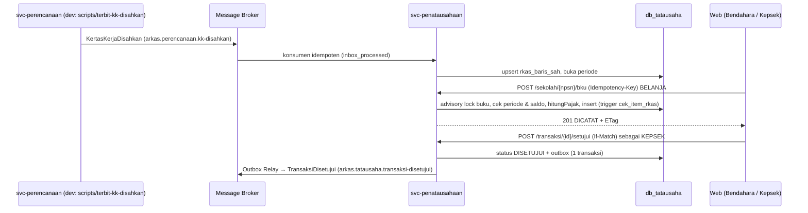

# Irisan vertikal 1 — svc-penatausahaan

Sumber rencana: *Konversi ARKAS Menjadi Arsitektur Microservices* (Google Drive), bab 3.4, 5.2.3 (SK-03), 7.3–7.7, 8.3, 10.2, 11.2.10, 13.1–13.4, 17, 18 (Tahap 1 "BOSP Inti").

## Cakupan

| Termasuk | Use case / rujukan |
|---|---|
| Konsumsi `KertasKerjaDisahkan` → proyeksi `rkas_baris_sah` + buka periode bulan berjalan; idempoten, tahan urutan acak, rantai `asal_baris_id` | 8.3, 7.3 |
| Catat **penerimaan**, **tarik tunai**, **setor tunai** | UC-10 |
| Catat **belanja** (wizard 3 langkah): rujuk baris RKAS disahkan, sisa anggaran, pajak otomatis (PPN, PPh 21, PPh 23, SSPD; maks 2 jenis) | UC-11, SK-03 |
| **Setujui / tolak** oleh Kepala Sekolah dengan If-Match/ETag dan pemisahan tugas | UC-13 |
| Outbox → `TransaksiDisetujui` (CloudEvents) via Outbox Relay | 13.2.6, 13.2.8 |
| BKU dengan saldo berjalan, BKP Tunai/Bank, ringkasan saldo/pagu/realisasi | 9.2 Tampilan 3a2 |
| RLS per NPSN, kredensial terpisah API vs pekerja, trigger integritas, partisi per tahun, larangan hapus | 7.6, 7.7, 13.4 |
| Halaman web BKU + laci wizard belanja + persetujuan | 10.2–10.5 |

**Belum termasuk (irisan berikutnya):** setor pajak/NTPN & BKP Pajak (UC-14), penutupan buku & rekonsiliasi + `PeriodeDitutup` (UC-15), transaksi Mitra SIPLah & koreksi pembalik (UC-12), `PenyaluranDicatat`, unggah bukti ke S3 (tabel `bukti`), konsumen `ReferensiDiubah` (tarif pajak masih seed dev), cakupan Dinas/Direktorat di RLS, OpenTelemetry, Helm/Kong.

## Alur

Status transaksi: `DICATAT → DISETUJUI | DITOLAK`. Belanja `DICATAT` langsung memesan anggaran (mencegah belanja ganda); `DITOLAK` membebaskannya. Saldo resmi hanya dari `DISETUJUI`; saldo *tersedia* = penerimaan disetujui − pengeluaran disetujui/menunggu.

## API (gateway → svc-penatausahaan)

| Metode & path | Peran | Catatan |
|---|---|---|
| `GET /api/v1/sekolah/{npsn}/bku?tahun&sumberDanaKode[&bulan][&buku=TUNAI\|BANK]` | semua (RLS) | baris BKU + saldo berjalan |
| `GET /api/v1/sekolah/{npsn}/bku/ringkasan` | semua | saldo, tersedia, pagu, realisasi, periode |
| `GET /api/v1/sekolah/{npsn}/bku/rkas` | semua | baris RKAS + realisasi + sisa + jenis pajak |
| `POST /api/v1/sekolah/{npsn}/bku/simulasi-pajak` | BENDAHARA | pratinjau langkah 3 |
| `POST /api/v1/sekolah/{npsn}/bku` | BENDAHARA | wajib `Idempotency-Key`; 201 / 200 replay |
| `GET /api/v1/transaksi/{id}` | semua (RLS) | `ETag: W/"versi"` |
| `POST /api/v1/transaksi/{id}/setujui` | KEPSEK | wajib `If-Match`; 412 bila versi berubah |
| `POST /api/v1/transaksi/{id}/tolak` | KEPSEK | `{ alasan }` |
| `POST /internal/v1/events` | dev saja | `DEV_EVENTS_ENABLED=true` + `X-Internal-Token` |

Galat: `application/problem+json` dengan `kode` (mis. `SALDO_TIDAK_CUKUP`, `MELEBIHI_ANGGARAN`, `PERIODE_BELUM_DIBUKA`, `PEMISAHAN_TUGAS`, `IDEMPOTENCY_KEY_DIPAKAI_ULANG`, `VERSI_BERUBAH`).

## Pertahanan berlapis untuk anggaran & akses
1. Zod di web dan di layanan (skema bersama `@arkas/kontrak`).
2. `ScopeGuard`: verifikasi JWT internal RS256, `@Izinkan(peran)`, `:npsn` = klaim untuk peran sekolah.
3. Layanan: advisory lock per buku, cek periode, saldo, sisa anggaran (pesan ramah).
4. PostgreSQL: RLS per NPSN dan per peran untuk INSERT/UPDATE, grant kolom (hanya kolom keputusan yang dapat di-UPDATE), trigger `cek_item_rkas` (mengunci baris RKAS), `tolak_periode_tertutup`, `jaga_transaksi`, larangan DELETE.

## Keputusan & penyimpangan dari rencana
- **SQL langsung (`pg`) alih-alih Prisma** untuk repository: RLS + `set_config` + trigger lebih jelas tanpa ORM; rencana 3.3 memang menyebut "Prisma + SQL langsung". Bisa ditambah Prisma nanti bila diinginkan.
- **Kamus data `tatausaha` disusun ulang**: dokumen microservices merujuk ke kamus data dokumen v2.0 yang tidak ditemukan di Drive. Kolom diturunkan dari teks rencana; mohon dicocokkan dengan dokumen v2.0.
- Kolom keputusan diberi nama `diputuskan_oleh/diputuskan_at` (dipakai untuk setuju **dan** tolak); aturan `diputuskan_oleh <> dibuat_oleh` setara dengan `disetujui_oleh <> dibuat_oleh` di rencana.
- Model BKU: belanja dicatat bruto sebagai pengeluaran; pajak yang dipungut menjadi baris penerimaan di buku yang sama sampai disetor (irisan UC-14).
- Tarif pajak & kode rekening di `90_seed_dev.sql` adalah **contoh**; nilai resmi wajib dari svc-referensi/Dinas.
- Broker: port `Broker` dengan adapter **memori** (dev/uji) dan **Kafka** (kafkajs). Kafka belum diuji terhadap broker sungguhan karena Docker tidak tersedia di lingkungan pembangunan.
- Front end memakai state React biasa, bukan React Hook Form; animasi CSS, bukan Framer Motion.
- `/api/v1/*` di Next.js dan pemilih peran adalah **pengganti dev** untuk API Gateway + svc-identitas (SSO).

## Bukti verifikasi
- `packages/aturan`: 13 uji unit, cakupan baris 100%.
- `svc-penatausahaan`: 19 uji integrasi pada PostgreSQL 16: autentikasi/cakupan, idempotensi event & HTTP, If-Match, pemisahan tugas, saldo, PPN/PPh 23/SSPD, BKU, trigger saat aplikasi dilewati, RLS lintas sekolah, penolakan membebaskan anggaran, dua belanja bersamaan, pergeseran RKAS v2, larangan hapus, event cacat.
- Skenario UI end-to-end (Playwright): tangkapan layar di `docs/tangkapan/`.
