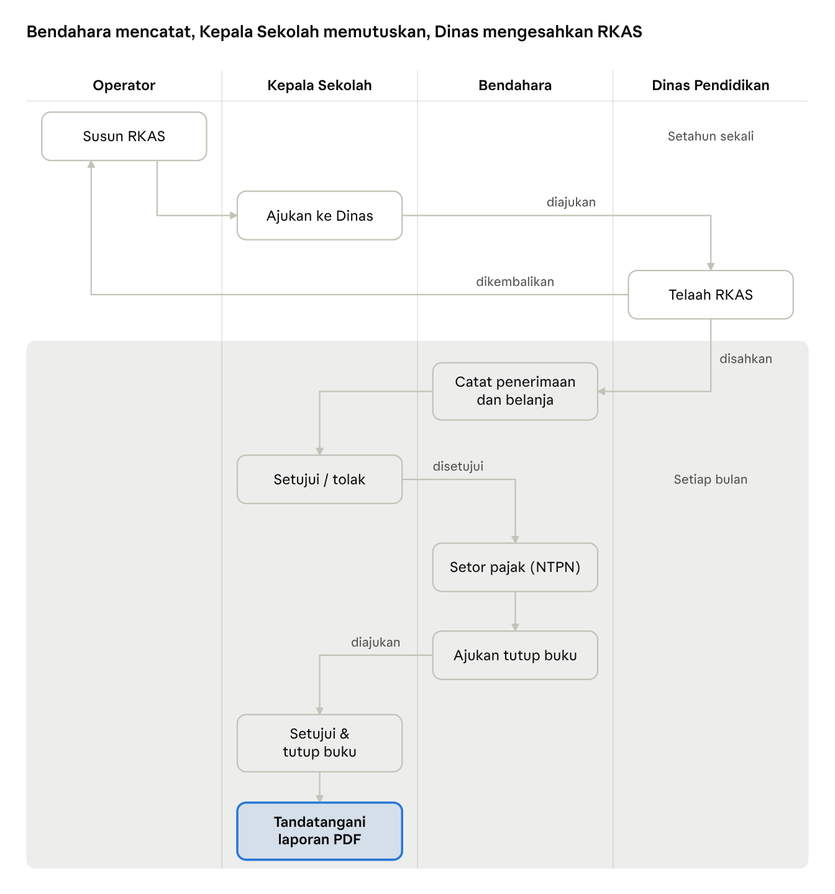

Panduan ini untuk Kepala Sekolah, Bendahara, dan Operator sekolah yang mengelola dana BOSP di ARKAS Web: dari menyusun RKAS sampai laporan bulanan bertanda tangan.

**Isi panduan**

1. Sekilas: siapa melakukan apa
2. Masuk dan memilih peran
3. Operator: menyusun RKAS
4. Kepala Sekolah: mengajukan, menyetujui, menutup
5. Bendahara: mencatat transaksi dan menutup buku
6. Laporan BKU bulanan
7. Pesan yang sering muncul

# Sekilas: siapa melakukan apa

Sekali setahun, RKAS disusun Operator, diajukan Kepala Sekolah, dan disahkan Dinas. Setiap bulan, Bendahara mencatat dan Kepala Sekolah memutuskan, sampai buku ditutup dan laporan ditandatangani.

{width=15cm}

Tidak ada langkah yang dapat dilewati: buku kas baru terbuka setelah RKAS disahkan, dan laporan baru dibuat setelah buku bulan itu ditutup.

# Masuk dan memilih peran

Semua pengguna masuk dengan akun SSO yang sama; yang membedakan hanyalah **peran aktif** yang dipilih setelah masuk.

1. Buka alamat ARKAS Web sekolah Anda di peramban, lalu klik **Masuk dengan SSO**.
2. Masuk dengan akun SSO Anda. Akun harus sudah didaftarkan oleh Admin Dinas atau Operator sekolah; bila belum, muncul pesan *Akun Anda belum memiliki peran aktif*. Hubungi admin sekolah atau Dinas.
3. Bila Anda punya lebih dari satu peran (misalnya Bendahara sekaligus Operator), halaman **Pilih peran** muncul. Pilih peran yang akan dipakai.
4. Aplikasi membuka halaman awal sesuai peran (lihat tabel di bawah).

*Halaman masuk di lingkungan uji coba. Di sekolah, halaman ini hanya menampilkan tombol Masuk dengan SSO; daftar pengguna contoh tidak muncul.*

| Peran | Halaman awal | Menu di bagian atas |
|---|---|---|
| Operator | Penganggaran (RKAS) | Penganggaran (RKAS), Penatausahaan (lihat saja), Kelola pengguna |
| Bendahara | Penatausahaan (Buku Kas Umum) | Penganggaran (RKAS), Penatausahaan |
| Kepala Sekolah | Penatausahaan (Buku Kas Umum) | Penganggaran (RKAS), Penatausahaan |

Untuk berganti peran tanpa keluar, pakai kotak pilihan peran di pojok kanan atas. Klik **Keluar** di sebelahnya bila selesai, terutama di komputer bersama.

Semua data yang Anda lihat dibatasi pada sekolah (NPSN) dari peran aktif. Bendahara tidak dapat menyetujui transaksinya sendiri, dan Kepala Sekolah tidak dapat mencatat transaksi: pemisahan tugas ini dijaga oleh sistem.

# Operator: menyusun RKAS

Operator (dan Bendahara) menyusun kertas kerja RKAS; Kepala Sekolah yang mengajukannya ke Dinas. Buka menu **Penganggaran (RKAS)**.

## Mengaktifkan kertas kerja (sekali setahun)

Bila tertulis *Kertas kerja 2026 belum diaktifkan*, klik **Aktifkan kertas kerja**. Pagu sekolah dari Dinas langsung tampil di bagian atas.

Setelah diaktifkan, pagu tampil di kiri dan tabel baris masih kosong. Kotak kuning *Belum dapat diajukan* menunjukkan pagu yang belum dianggarkan.

## Mengisi baris anggaran

1. Klik **+ Tambah baris**.
2. Pilih **Komponen BOSP**, isi **Kode rekening** (misalnya 5.1.02.01.01.0024), **Uraian**, **Volume**, **Satuan**, dan **Harga satuan**. Total dihitung otomatis.
3. Klik **Simpan baris**. Jadwal kas dibagi rata ke 12 bulan.
4. Ulangi sampai seluruh pagu teranggarkan. Untuk mengoreksi, pakai **Ubah** atau **Hapus** pada baris.

{width=9cm}

## Membaca hasil pemeriksaan

Aplikasi memeriksa RKAS terhadap juknis setiap kali ada perubahan. Tombol **Ajukan ke Dinas** milik Kepala Sekolah baru aktif bila tidak ada galat:

| Pesan | Artinya | Yang dilakukan |
|---|---|---|
| Total anggaran melebihi pagu | Jumlah semua baris lebih besar dari pagu | Kurangi volume/harga atau hapus baris |
| Masih ada pagu yang belum dianggarkan | Ada sisa pagu | Tambah baris sampai pagu habis |
| Komponen melebihi batas | Komponen dibatasi persentase (misalnya honor maksimal 20%) | Kurangi baris di komponen itu |
| Komponen / kode rekening tidak dikenal | Kode sudah tidak berlaku di referensi nasional | Pilih komponen atau rekening lain |

Bila pagu sudah habis teranggarkan dan semua komponen dalam batas, kotak hijau *Memenuhi aturan juknis* muncul. Batas komponen ditandai garis merah pada bilahnya.

## Setelah dikembalikan Dinas

Bila Verifikator Dinas mengembalikan RKAS, muncul kotak *Dikembalikan Verifikator Dinas* beserta alasannya, dan catatan per baris di kolom **Catatan**. Perbaiki baris yang disebut, lalu minta Kepala Sekolah mengajukan ulang.

## Pergeseran setelah disahkan

RKAS yang sudah **Disahkan** tidak dapat diubah langsung. Klik **Buat pergeseran/perubahan** untuk membuat versi baru; versi lama tetap tersimpan di tab **Versi**. Total baris tidak boleh di bawah realisasi yang sudah dibelanjakan.

## Kelola pengguna

Di menu **Kelola pengguna**, Operator dapat memberi peran Bendahara, Kepala Sekolah, atau Komite kepada warga sekolah berdasarkan email SSO mereka, dan mencabutnya bila tugasnya berakhir. Klik **+ Tambah pengguna**, isi email SSO dan pilih perannya. Untuk mengakhiri tugas seseorang, klik **Cabut** di samping perannya.

# Kepala Sekolah: mengajukan, menyetujui, menutup

Kepala Sekolah tidak mencatat transaksi; tugasnya memeriksa dan memutuskan. Setiap keputusan tercatat atas nama Anda dan tidak dapat dibatalkan.

## Mengajukan RKAS ke Dinas

1. Buka menu **Penganggaran (RKAS)** dan periksa baris yang disusun Operator atau Bendahara.
2. Bila hasil pemeriksaan tidak menunjukkan galat, klik **Ajukan ke Dinas** lalu konfirmasi. Status berubah menjadi *Diajukan ke Dinas*, dan kertas kerja tidak dapat diubah selama ditelaah.
3. Bila Dinas mengembalikan, minta penyusun memperbaiki, lalu ajukan lagi. Setelah *Disahkan*, RKAS otomatis menjadi dasar Buku Kas Umum.

## Menyetujui atau menolak transaksi

1. Buka menu **Penatausahaan**. Di bagian atas tertulis *N transaksi menunggu persetujuan Anda*.
2. Pada tab **Buku Kas Umum**, periksa uraian, nilai, dan bukti setiap transaksi berstatus *Menunggu persetujuan*.
3. Klik **Setujui** bila sesuai. Transaksi yang disetujui tidak dapat diubah lagi.
4. Klik **Tolak** bila tidak sesuai dan tulis alasannya (wajib). Transaksi yang ditolak pindah ke kotak merah *transaksi ditolak* di atas Buku Kas Umum beserta alasannya, dan Bendahara melihat kotak yang sama. Bila belanja ditolak, pajaknya ikut batal.

Belanja tampil bersama pajak yang dipungut di bawahnya (misalnya *Pungut SSPD*), sehingga Anda dapat memeriksa nilai bruto dan pajaknya sebelum menyetujui.

Setoran pajak di tab **BKP Pajak** disetujui dengan cara yang sama.

## Menyetujui penutupan buku bulanan

1. Setelah Bendahara mengajukan, buka tab **Penutupan Buku Kas**. Periksa saldo awal, penerimaan, pengeluaran, dan saldo akhir per buku, serta **Berita acara pemeriksaan kas**: saldo buku dibanding rekening koran dan kas fisik.
2. Bila sesuai, klik **Setujui & tutup buku**. Periode bulan itu dikunci permanen, dan laporan BKU bulanan dibuat otomatis.
3. Bila ada yang keliru, klik **Kembalikan** dan tulis alasannya. Transaksi bulan itu terbuka lagi untuk Bendahara.

*Selisih bank dan selisih kas Rp 0 berwarna hijau. Bila ada selisih, penjelasan Bendahara tampil di bawahnya. Sebelum Bendahara mengajukan, tab ini hanya menampilkan Belum diajukan.*

# Bendahara: mencatat transaksi dan menutup buku

Bendahara mencatat semua uang masuk dan keluar di menu **Penatausahaan**. Setiap catatan berstatus *Menunggu persetujuan* dan baru menggerakkan saldo setelah disetujui Kepala Sekolah.

Periode buku kas terbuka otomatis setelah RKAS disahkan Verifikator Dinas. Sebelum itu, halaman menampilkan *RKAS belum disahkan* dan tombol pencatatan belum dapat dipakai. Halaman ini punya tab **Buku Kas Umum**, **BKP Tunai**, **BKP Bank**, **BKP Pajak**, **Penutupan Buku Kas**, dan **Laporan**.

## Mencatat penerimaan dana BOSP

1. Klik **Catat penerimaan**.
2. Isi **Tanggal**, **Uraian** (misalnya *Penerimaan dana BOSP Reguler tahap 1*), **Nilai (Rp)**, dan **No. bukti** bila ada.
3. Klik **Simpan**.

## Menarik tunai dari rekening

Belanja tunai memerlukan saldo kas tunai. Tarik tunai baru dapat disimpan setelah penerimaan di bank disetujui Kepala Sekolah, karena saldo bank harus cukup. Klik **Tarik tunai**, isi nilai dan tanggal, lalu **Simpan**. Saldo tunai bertambah setelah Kepala Sekolah menyetujui.

## Mencatat belanja (3 langkah)

1. Klik **+ Catat belanja**. Pada langkah **Detail & saldo**, isi tanggal transaksi, pilih **Cara bayar** (non-tunai/bank atau tunai), lalu isi no. bukti/nota, nama toko atau penyedia, dan uraian belanja. Hapus centang *Penyedia memiliki NPWP* bila penyedia tidak punya NPWP: tarif PPh-nya lebih tinggi. Klik **Lanjut →**.

2. Pada langkah **Pilih dari RKAS**, cari kegiatan, kode rekening, atau uraian, lalu klik baris RKAS yang dibelanjakan. Sesuaikan uraian item, volume, dan harga satuan; sisa anggaran baris tampil di bawah namanya. Aplikasi menandai merah bila melebihi sisa anggaran. Klik **Lanjut →**.

3. Pada langkah **Pajak & simpan**, periksa nilai bruto, pajak yang dihitung otomatis dari kode rekening dan wilayah sekolah, dan nilai yang dibayar ke penyedia. Klik **Simpan belanja**.

Kotak di bagian atas laci selalu menampilkan saldo tersedia dan saldo setelah belanja. Bila saldo tunai kurang, aplikasi menawarkan tombol **Catat tarik tunai lebih dulu**.

Pajak yang dipungut (PPN, PPh 21/23, atau pajak daerah SSPD) langsung tercatat di BKP Pajak sebagai utang pajak yang wajib disetor. Tarif SSPD mengikuti Perda wilayah sekolah bila Dinas sudah menetapkannya. Di Buku Kas Umum, setiap belanja diikuti baris pungutan pajaknya, dan setoran pajak tampil dengan NTPN sebagai nomor bukti.

## Bila transaksi ditolak

Transaksi yang ditolak Kepala Sekolah tampil di kotak merah *transaksi ditolak* di atas Buku Kas Umum, beserta alasannya. Transaksi itu tidak masuk saldo. Perbaiki penyebabnya, lalu klik **Catat ulang**: formulir yang sesuai langsung terbuka. Kotak ini hilang setelah buku bulan itu ditutup.

## Menyetor pajak

1. Buka tab **BKP Pajak**. Bagian *Pajak belum disetor* menampilkan pungutan dari belanja yang sudah disetujui.

2. Centang pungutan yang sejenis (misalnya semua SSPD, atau semua PPN), lalu klik **Catat setor pajak**.
3. Isi **NTPN** (16 karakter dari bukti penerimaan negara) dan **Tanggal setor**, lalu pilih **Dibayar dari**: rekening bank atau kas tunai. Satu NTPN hanya dapat dipakai sekali.
4. Klik **Simpan setoran**. Setoran juga menunggu persetujuan Kepala Sekolah; bila ditolak, pajak kembali menjadi terutang.

## Menutup buku kas bulanan

1. Setelah akhir bulan, buka tab **Penutupan Buku Kas**. *Daftar periksa penutupan* harus hijau semua: semua transaksi sudah diputuskan Kepala Sekolah dan periode sebelumnya sudah ditutup. Pajak yang belum disetor tampil sebagai peringatan kuning, tetapi tidak menghalangi penutupan.
2. Di bagian **Rekonsiliasi & hitung kas**, isi **Saldo rekening koran akhir bulan** dan **Hasil hitung kas fisik**. Angka buku bank dan buku tunai tertulis di bawah setiap kolom sebagai pembanding.

3. Bila angka yang diisi berbeda dari buku, muncul kolom **Penjelasan selisih** yang wajib diisi (minimal 10 karakter). Tombol pengajuan baru aktif setelah penjelasan diisi.

4. Klik **Ajukan penutupan** (nama bulan). Mulai saat itu transaksi bulan ini dikunci sampai Kepala Sekolah memutuskan.
5. Bila dikembalikan, muncul kotak *Dikembalikan Kepala Sekolah* beserta alasannya. Perbaiki, lalu ajukan lagi.

# Laporan BKU bulanan

Laporan BKU bulanan dibuat otomatis dalam bentuk PDF begitu Kepala Sekolah menyetujui penutupan buku; tidak ada yang perlu dicetak manual.

1. Buka tab **Laporan** di menu Penatausahaan. Status laporan bergerak dari *Sedang dibuat* ke *Siap ditandatangani*, biasanya dalam hitungan detik.
2. Klik **Lihat PDF** untuk membuka laporan dan periksa isinya. Sebelum PDF dibuat, sistem mencocokkan baris BKU dengan ringkasan penutupan; laporan tidak dibuat bila ada selisih (status *Gagal dibuat*).
3. Kepala Sekolah menandatangani laporan yang berstatus *Siap ditandatangani*. Status menjadi *Ditandatangani*, dan PDF bertanda tangan dapat dibuka oleh Bendahara dan Kepala Sekolah.

*Catatan: pada versi saat ini tombolnya bertuliskan Tandatangani (simulasi) dan dokumen diberi tanda "bukan TTE yang sah". Tanda tangan elektronik resmi (BSrE) belum tersambung.*

# Pesan yang sering muncul

Setiap penolakan menampilkan pesan dan kode di kotak merah; sebutkan kode itu bila menghubungi admin.

| Pesan atau kode | Penyebab | Yang dilakukan |
|---|---|---|
| RKAS belum disahkan | Periode buku kas belum dibuka | Pastikan RKAS sudah diajukan Kepala Sekolah dan disahkan Dinas |
| Saldo tunai belum cukup / Saldo bank tidak cukup | Saldo buku yang dipilih kurang untuk belanja ini | Catat tarik tunai (atau penerimaan) lebih dulu, lalu tunggu persetujuan |
| MELEBIHI_ANGGARAN | Belanja melebihi sisa anggaran baris RKAS | Kurangi nilai, atau ajukan pergeseran RKAS |
| PEMISAHAN_TUGAS | Orang yang sama mencatat dan menyetujui | Persetujuan harus oleh Kepala Sekolah, bukan pencatat |
| PERIODE_TERTUTUP | Bulan itu sudah diajukan atau ditutup | Catat di bulan berjalan; bila masih diajukan, minta Kepala Sekolah mengembalikan |
| PERIODE_SEBELUMNYA_BELUM_DITUTUP | Bulan sebelumnya belum ditutup | Tutup bulan sebelumnya lebih dulu |
| NTPN_TIDAK_VALID / NTPN_SUDAH_DIPAKAI | NTPN bukan 16 karakter, atau sudah dipakai setoran lain | Salin ulang NTPN dari bukti penerimaan negara |
| Akun Anda belum memiliki peran aktif | Akun SSO belum diberi peran di sekolah | Minta Operator atau Admin Dinas memberi peran |

## Pertanyaan umum

- *Transaksi salah catat padahal sudah disetujui?* Transaksi yang disetujui tidak dapat diubah atau dihapus. Catat transaksi koreksi dengan uraian yang menjelaskan, agar jejak audit tetap utuh.
- *Mengapa tarif pajak daerah berbeda dari sekolah lain?* Tarif SSPD mengikuti Perda wilayah sekolah yang ditetapkan Dinas, dan bisa dibebaskan di wilayah tertentu.
- *Saya Bendahara sekaligus Operator, mengapa tombol berbeda?* Tombol mengikuti peran aktif. Ganti peran di pojok kanan atas.
