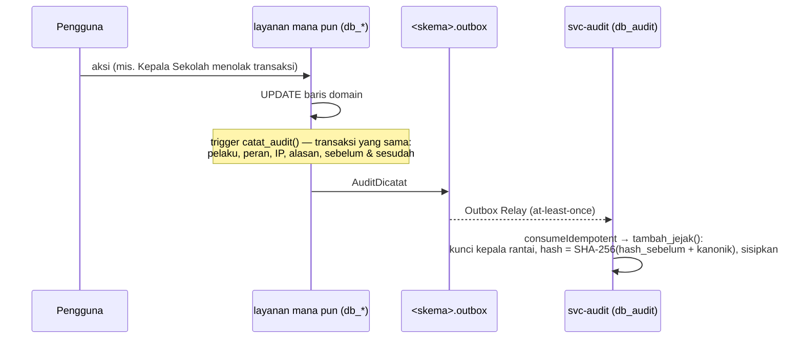
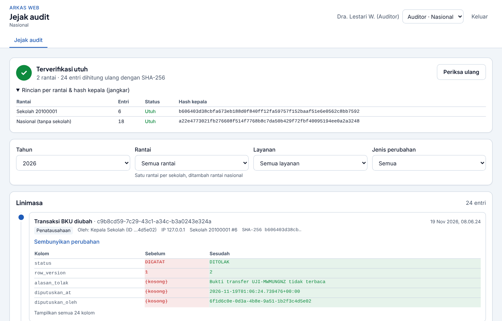
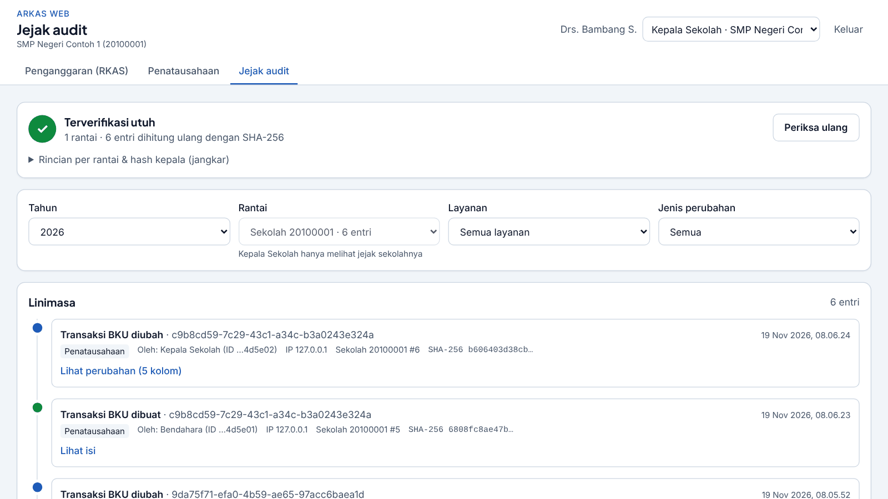

# svc-audit — jejak audit berantai hash (UC-31)

Layanan kesembilan dari rancangan microservices. Tugasnya hanya satu: **mencatat setiap perubahan data domain di semua layanan ke jejak yang tidak bisa diubah**, dan membuktikan bahwa jejak itu masih utuh. svc-audit tidak menerbitkan event (Bab 3: *Tidak ada*).

| | |
|---|---|
| Port | 3108 |
| Basis data | `db_audit`, skema `audit` |
| Tabel | `jejak` (append-only, partisi per tahun), `kepala_rantai`, `inbox_processed` |
| Mengonsumsi | `AuditDicatat` (topik `arkas.audit.dicatat`) dari kelima layanan lain |
| Peran | Auditor & Balai SDSP (semua rantai), Kepala Sekolah (rantai sekolahnya) |

## Alur

- **Trigger bersama** `db/_bersama/audit.sql` disertakan ke migrasi `70_audit.sql` tiap layanan (`-- #sertakan _bersama/audit.sql <skema>`). Karena ditulis di transaksi yang sama dengan perubahan datanya, tidak ada perubahan yang lolos tanpa jejak.
- **Data pribadi disembunyikan** (UU PDP): untuk `auth.pengguna`, kolom email, nama, dan identitas SSO tidak ikut dicatat. Login (`masuk_terakhir_at`) tidak dianggap perubahan.
- Tabel yang diaudit: penatausahaan (`periode`, `transaksi`, `pajak`, `rekonsiliasi`), perencanaan (`pagu`, `kertas_kerja`, `baris_kertas_kerja`, `verifikasi`, `catatan_baris`), identitas (`pengguna`, `peran_pengguna`), referensi (9 tabel referensi), pelaporan (`laporan`). Tabel berpartisi dicatat dengan nama induknya (`transaksi`, bukan `transaksi_2026`).

## Rantai hash

- Satu rantai per **(tahun, NPSN)**, ditambah rantai **NASIONAL** untuk data tanpa sekolah (referensi, pengguna). Sesuai Bab 19, ini mencegah satu kunci urutan nasional menjadi titik antre.
- `hash = SHA-256(hash_sebelum + "\n" + kanonik(entri))`; entri pertama memakai 64 angka nol. Teks kanonik dibuat di PostgreSQL (`jsonb::text` yang urutan kuncinya baku, waktu UTC mikrodetik), jadi hasil hitung ulang selalu sama.
- **Append-only** berlapis: role API hanya `SELECT`; role pekerja hanya bisa menambah lewat fungsi `tambah_jejak()`; trigger menolak `UPDATE`, `DELETE`, dan `TRUNCATE` (`JEJAK_APPEND_ONLY`), bahkan untuk pemilik tabel.
- **Verifikasi** (`verifikasi_rantai`) menghitung ulang semua hash dan mendeteksi:

| Alasan | Artinya |
|---|---|
| `ISI_BERUBAH` | isi entri diubah setelah dicatat |
| `TAUTAN_RUSAK` | `hash_sebelum` tidak sama dengan hash entri sebelumnya |
| `URUTAN_TERPUTUS` | ada entri yang dihapus di tengah rantai |
| `ENTRI_HILANG` | entri di ujung rantai dihapus (tidak cocok lagi dengan `kepala_rantai`) |

Hash kepala tiap rantai ditampilkan di layar sebagai **jangkar**. Auditor bisa mencatatnya di berita acara; kalau seluruh rantai disusun ulang oleh pihak yang punya akses DBA, jangkar lama tidak akan cocok lagi.

## API (`/api/v1/audit/*`, gateway 11.2.16)

| Metode & path | Isi |
|---|---|
| `GET /audit/jejak?tahun&rantai&layanan&tabel&kunci&pelakuId&aksi&dari&sampai&halaman&ukuran` | linimasa, terbaru dulu, dengan `sebelum`/`sesudah` |
| `GET /audit/rantai?tahun` | daftar rantai yang boleh diakses: jumlah entri, hash kepala |
| `GET /audit/verifikasi?tahun[&rantai]` | `{ utuh, data: [{ rantai, utuh, diperiksa, rusak: {urutan, alasan} \| null, hashKepala }] }` |

Kepala Sekolah yang meminta rantai sekolah lain mendapat **403 `DI_LUAR_CAKUPAN`**. Peran lain (Bendahara, Dinas, dan seterusnya) mendapat 403.

## Tampilan

Menu **Jejak audit** (Auditor, Balai SDSP, Kepala Sekolah):
- lencana verifikasi (Terverifikasi utuh / Rantai rusak) beserta rincian hash kepala;
- saringan tahun, rantai, layanan, dan jenis perubahan;
- linimasa dengan tabel perubahan *sebelum → sesudah* berwarna (bawaannya hanya kolom yang berubah).

## Pengujian

- `apps/svc-audit/test/audit.e2e.spec.ts` (5 uji): alur sungguhan trigger `db_ref` → outbox → svc-audit; idempotensi; pesan tidak sah masuk *dead letter*; RLS per peran; perusakan oleh DBA terdeteksi (`ISI_BERUBAH`) tanpa memengaruhi rantai sekolah lain.
- `apps/web/e2e/audit.e2e.ts` (2 uji UI): perubahan Balai muncul di linimasa Auditor dengan nilai sebelum/sesudah; Kepala Sekolah hanya melihat rantai sekolahnya.
- Uji layanan lain disesuaikan agar menyaring `AuditDicatat` saat menghitung event domain.

## Belum dikerjakan

Partisi tahun berikutnya dibuat otomatis (sekarang 2025–2027 + DEFAULT); jangkar hash berkala ke penyimpanan eksternal (WORM/S3 Object Lock); nama pelaku di layar (perlu proyeksi nama dari svc-identitas, dengan memperhatikan UU PDP); audit stream lewat Kafka di produksi (sekarang `BROKER=http` di dev).
