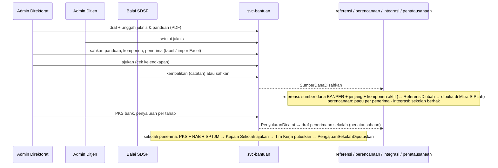
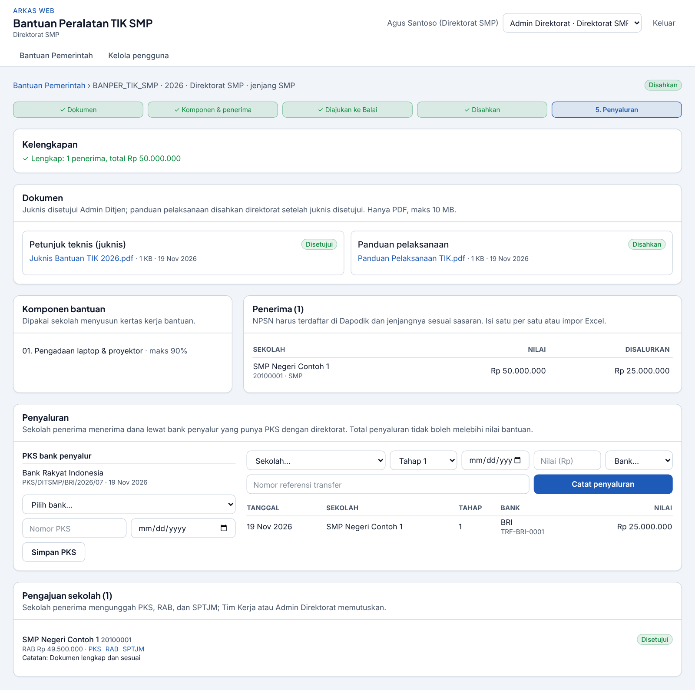
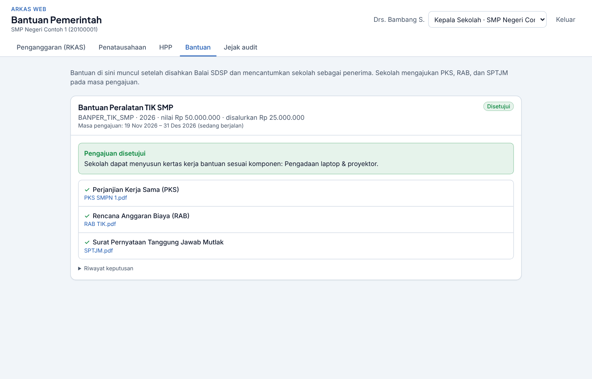

# svc-bantuan — Bantuan Pemerintah

Mengelola sumber dana **Bantuan Pemerintah** (BANPER) dari draf direktorat teknis sampai uang sampai di rekening sekolah:

| | |
|---|---|
| Port | 3111 |
| Basis data | `db_banper`, skema `banper` |
| Tabel | `sumber_dana_bantuan`, `dokumen`, `komponen_bantuan`, `penerima`, `impor_penerima`, `pks_bank`, `penyaluran`, `pengajuan_sekolah`, `ref_bank`, proyeksi `ref_sekolah_lokal` & `ref_direktorat_lokal` |
| Mengonsumsi | `ReferensiDiubah` (sekolah & direktorat) |
| Menerbitkan | `SumberDanaDisahkan`, `PenyaluranDicatat`, `PengajuanSekolahDiputuskan` |
| Use case | UC-17/18 pengajuan sekolah, UC-21 juknis, UC-22 panduan, UC-23 mengajukan, UC-24 verifikasi, UC-25 penerima, UC-26 pengesahan, UC-27 PKS bank, UC-28 penyaluran, UC-29 komponen |

## Alur (SK-06, SK-07, SK-09, SK-10)

Siklus status ditulis sebagai fungsi murni di `packages/aturan/src/bantuan.ts` (`transisiSumberDanaBantuan`, `putuskanDokumen`, `transisiPengajuanSekolah`, `cekKelengkapan`, `dalamMasaPengajuan`):

| Objek | Siklus |
|---|---|
| Sumber dana | DRAF → DIAJUKAN → DISAHKAN; DIAJUKAN → DIKEMBALIKAN → DIAJUKAN |
| Juknis | DIUNGGAH → DISETUJUI / DITOLAK, diputuskan **Admin Ditjen** dari direktorat itu |
| Panduan | DIUNGGAH → DISAHKAN / DITOLAK, oleh **Admin Direktorat**, dan hanya setelah juknis disetujui |
| Pengajuan sekolah | DRAF → DIAJUKAN → DISETUJUI / DITOLAK / DIKEMBALIKAN, diputuskan **Tim Kerja** atau Admin Direktorat |

## Aturan yang ditegakkan

- **Kelengkapan sebelum diajukan**: juknis disetujui, panduan disahkan, minimal 1 komponen, minimal 1 penerima (`BELUM_LENGKAP` beserta daftar yang kurang).
- **Penerima**: NPSN harus ada di data sekolah (Dapodik lewat svc-referensi) dan jenjangnya termasuk sasaran (`PENERIMA_TIDAK_SAH`).
- **Impor Excel (SK-07)**: dikerjakan pekerja asinkron, **semua atau tidak sama sekali**. Satu baris salah membuat seluruh berkas ditolak, disertai daftar kesalahan per baris (NPSN tidak valid/ganda/tidak ada, jenjang salah, nilai bukan angka). Templat `.xlsx` bisa diunduh.
- **Terkunci setelah diajukan atau disahkan**: trigger `kunci_setelah_sah` pada penerima & komponen (`SUMBER_DANA_TERKUNCI`).
- **`cek_penyaluran`** (trigger): sumber dana sudah DISAHKAN, ada PKS dengan bank penyalurnya, sekolah termasuk penerima sah, dan total penyaluran ≤ nilai bantuan. Penyaluran bersifat final (`PENYALURAN_FINAL`).
- **Pengajuan sekolah**: hanya dalam masa pengajuan; satu pengajuan aktif per sekolah per bantuan (`ux_pengajuan_aktif`); dokumen PKS, RAB (dengan total ≤ nilai bantuan), dan SPTJM wajib; **hanya Kepala Sekolah** yang mengajukan (SPTJM adalah pernyataannya).
- **Berkas**: diunggah sebagai body biner, maksimal 10 MB. Jenisnya dicek lewat tanda tangan berkas (`%PDF-`, ZIP untuk `.xlsx`), bukan dari ekstensi. Setiap berkas disimpan bersama SHA-256-nya dan diunduh dengan `nosniff`. Pengembangan memakai folder lokal; produksi memakai S3 + pemindaian malware.

## Cakupan (RLS `boleh_lihat`)

| Peran | Yang terlihat / dikerjakan |
|---|---|
| Admin Direktorat | sumber dana direktoratnya: menyusun, dokumen panduan, komponen, penerima, PKS, penyaluran, keputusan pengajuan |
| Admin Ditjen | sumber dana direktorat di bawah ditjennya: memutuskan juknis |
| Tim Kerja | sumber dana direktoratnya: memutuskan pengajuan sekolah |
| Balai SDSP | semua: mengembalikan / mengesahkan |
| Pemantau, Auditor | semua (baca saja) |
| Sekolah | hanya bantuan yang **sudah disahkan dan mencantumkan sekolahnya** (fitur 14), data penerima & penyaluran miliknya sendiri |

## API (11.2.5–11.2.7)

| Metode & path | Isi |
|---|---|
| `GET/POST /api/v1/sumber-dana`, `GET/PUT /sumber-dana/{kode}` | daftar, buat draf, detail (kelengkapan, dokumen, komponen, penerima, PKS, penyaluran, impor) |
| `POST /sumber-dana/{kode}/dokumen/{JUKNIS|PANDUAN}?nama=` (body PDF), `GET /dokumen/{id}/berkas`, `POST /dokumen/{id}/keputusan` | dokumen |
| `PUT/DELETE /sumber-dana/{kode}/komponen/{k}`, `PUT/DELETE /sumber-dana/{kode}/penerima/{npsn}` | komponen & penerima |
| `GET /sumber-dana/{kode}/penerima/templat`, `POST /impor/penerima/{kode}` (body XLSX), `GET /impor/{id}` | impor Excel |
| `POST /sumber-dana/{kode}/{ajukan|kembalikan|sahkan}` | siklus |
| `GET /bank`, `POST /sumber-dana/{kode}/pks-bank`, `POST /sumber-dana/{kode}/penyaluran` | PKS & penyaluran |
| `GET /sekolah/{npsn}/pengajuan-bantuan`, `POST /pengajuan-bantuan`, `POST /pengajuan-bantuan/{id}/dokumen/{PKS|RAB|SPTJM}?nilaiRab=`, `POST /pengajuan-bantuan/{id}/ajukan` | sekolah |
| `GET /sumber-dana/{kode}/pengajuan`, `POST /pengajuan-bantuan/{id}/keputusan` | penelaah |

## Tampilan

- **Bantuan Pemerintah** (pusat): daftar, lalu halaman detail berisi tahapan (Dokumen → Komponen & penerima → Diajukan → Disahkan → Penyaluran), kelengkapan, dokumen dengan tombol keputusan sesuai peran, penerima beserta impor Excel dan daftar kesalahannya, PKS & penyaluran, serta pengajuan sekolah.
- **Bantuan** (sekolah): kartu per bantuan yang diterima, dengan unggah PKS/RAB/SPTJM dan tombol ajukan untuk Kepala Sekolah.

## Pengujian

- `apps/svc-bantuan/test/bantuan.e2e.spec.ts` (9 uji): pembuatan draf & cakupan, dokumen & urutan keputusan, validasi penerima, impor Excel (ditolak seluruhnya / diterapkan), kembalikan → sahkan → `SumberDanaDisahkan`, `cek_penyaluran`, pengajuan sekolah sampai keputusan Tim Kerja.
- `packages/aturan/test/bantuan.spec.ts`: fungsi siklus.
- Konsumen hilir: `svc-referensi` (referensi BANPER), `svc-perencanaan` (pagu), `svc-integrasi` (sekolah berhak), `svc-penatausahaan` (penyaluran).
- `apps/web/e2e/bantuan.e2e.ts` (2 uji UI lintas 6 peran, idempoten), sampai pembukaan di Mitra tiruan dikonfirmasi DIBUKA.

## Belum dikerjakan

Kertas kerja bantuan yang ditelaah Tim Kerja di svc-perencanaan (SK-10, lanjutan setelah `PengajuanSekolahDiputuskan`); buku kas per sumber dana bantuan di BKU sekolah, termasuk tombol "catat penerimaan" dari draf penyaluran; adendum penerima setelah disahkan; impor penyaluran lewat Excel; `SumberDanaDiubah`.
