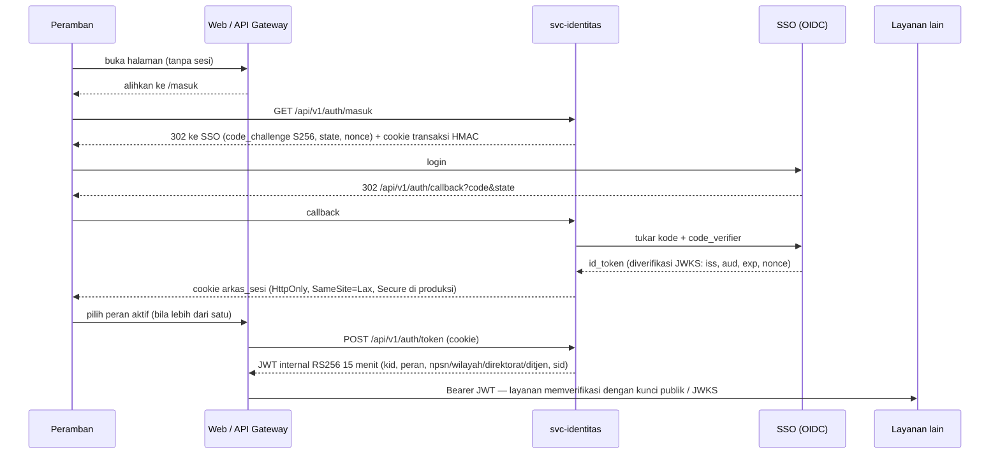

# svc-identitas — SSO, sesi, peran aktif, JWT internal, pengguna berjenjang

Rujukan rencana: 3.4 (svc-identitas, db_auth: SSO, sesi, peran, cakupan, penerbitan JWT internal; terbitkan `PenggunaDibuat`, `PeranDiubah`), 4.1 (13 peran & cakupan), UC-01, UC-20, SK-12 (penambahan pengguna berjenjang), 11.2.1 & 11.2.3, 16.1 (`OIDC_ISSUER` & `JWT_PRIVATE_KEY` hanya di svc-identitas), 18 Tahap 0.

## Alur masuk (UC-01)

- **Penautan akun:** pengguna didaftarkan admin berdasarkan email. Pada masuk SSO pertama, akun ditautkan lewat email **terverifikasi** (`email_verified`); masuk berikutnya dikenali lewat `(iss, sub)`.
- **Sesi:**
  - token acak 32 bita di cookie; basis data hanya menyimpan SHA-256-nya;
  - masa berlaku 8 jam, idle 60 menit, bisa dicabut saat keluar;
  - peran tunggal otomatis menjadi peran aktif.
- **Pengalihan setelah masuk** hanya ke jalur relatif (tanpa open redirect).
- **JWKS:** `GET /.well-known/jwks.json` (kid = thumbprint RFC 7638). Kunci privat hanya ada di svc-identitas.
- **Masuk dev** (`AUTH_DEV_ENABLED=true`): memilih pengguna contoh tanpa SSO. Wajib mati di produksi; tanpa OIDC maupun mode dev, layanan menolak menyala.

## Pengelolaan pengguna berjenjang (UC-20, SK-12)
| Pengelola (peran aktif) | Boleh memberi | Cakupan |
|---|---|---|
| SUPER_ADMIN (Balai SDSP) | SUPER_ADMIN, ADMIN_DITJEN, ADMIN_DINAS, PEMANTAU, AUDITOR | wilayah/ditjen harus dikenal; Auditor wajib berbatas waktu |
| ADMIN_DITJEN | ADMIN_DIREKTORAT | direktorat di bawah ditjennya |
| ADMIN_DIREKTORAT | TIM_KERJA | direktoratnya sendiri |
| ADMIN_DINAS | ADMIN_DINAS, VERIFIKATOR_DINAS, OPERATOR | wilayah turunannya (kode hierarkis 2/4/6 digit); Operator untuk sekolah di wilayahnya |
| OPERATOR | BENDAHARA, KEPSEK, KOMITE | sekolahnya sendiri |

Aturan tambahan:
- Tidak boleh memberi atau mencabut peran untuk diri sendiri.
- Mencabut peran tetap diizinkan walau masa berlakunya sudah lewat.
- Pencabutan langsung melepas peran aktif pada sesi yang sedang memakainya, sehingga penerbitan token berikutnya ditolak.

**Pertahanan berlapis:** fungsi murni `periksaPemberianPeran` (pesan jelas), RLS `dalam_kelola()` di db_auth, CHECK bentuk cakupan per peran, indeks unik peran aktif, dan trigger larangan hapus/ubah peran. Email yang sudah terdaftar di luar cakupan ditolak `EMAIL_SUDAH_TERDAFTAR` tanpa membuka datanya.

## API
| Metode & path | Akses | Catatan |
|---|---|---|
| `GET /api/v1/auth/metode` | publik | `{ sso, dev }` |
| `GET /api/v1/auth/masuk?kembali=` → `GET /api/v1/auth/callback` | publik | OIDC Authorization Code + PKCE |
| `POST /api/v1/auth/dev-masuk` | dev saja | `{ email }` |
| `POST /api/v1/auth/keluar` | cookie | cabut sesi |
| `GET /api/v1/me`, `PUT /api/v1/me/peran-aktif` | cookie | profil, peran berlaku, peran aktif |
| `POST /api/v1/auth/token` | cookie | JWT internal untuk peran aktif (`409 PERAN_BELUM_DIPILIH`) |
| `GET /.well-known/jwks.json` | publik | kunci publik verifikasi |
| `GET/POST /api/v1/admin/pengguna`, `POST /{id}/peran`, `DELETE /{id}/peran/{peranId}` | JWT pengelola | UC-20 |

## Web
- Proxy `/api/v1/*` (pengganti API Gateway) tidak lagi mencetak token sendiri. Cookie sesi ditukar ke svc-identitas menjadi JWT internal untuk setiap permintaan ke layanan lain; rute `auth/*` dan `me*` meneruskan cookie.
- `middleware.ts` mengalihkan halaman tanpa sesi ke `/masuk`.
- Halaman baru:
  - `/masuk` (SSO dan pilihan pengguna contoh untuk dev);
  - `/pilih-peran`;
  - `/penelaahan` (Verifikator/Tim Kerja);
  - `/admin/pengguna` (UC-20).
- Kepala halaman menampilkan peran aktif dari svc-identitas (ganti peran) dan tombol Keluar.

## Pengujian
- `packages/aturan`: +29 uji peran (`validasiBentukCakupan`, `periksaPemberianPeran`, pencabutan); total 73.
- `svc-identitas`: 13 uji integrasi melawan **IdP OIDC tiruan** (discovery, JWKS, token endpoint yang memeriksa PKCE S256). Mencakup:
  - SSO sukses dan penautan email terverifikasi;
  - pemilihan peran;
  - verifikasi JWT lewat JWKS;
  - penolakan: state, cookie dipalsukan, nonce, akun belum terdaftar, email belum terverifikasi, galat IdP;
  - open redirect;
  - sesi: keluar, idle, hash token, peran milik orang lain;
  - pengelolaan berjenjang dan event;
  - pencabutan melepas peran aktif;
  - RLS saat aplikasi dilewati;
  - larangan hapus.
- UI (Playwright): tangkapan `docs/tangkapan/20–23`.

## Belum ada
- Integrasi SSO resmi Kemendikdasmen (perlu `client_id`, rahasia, dan URL redirect terdaftar; klien OIDC generik sudah siap).
- Konsumen `ReferensiDiubah`/`SekolahDisinkron` (referensi wilayah/sekolah masih seed).
- Logout SSO (`end_session_endpoint`) dan pembatasan laju percobaan masuk.
- Rotasi kunci JWKS (lebih dari satu `kid`) dan verifikasi JWKS di layanan lain (masih berkas kunci publik).
- Pencabutan sesi/token seketika saat peran dicabut (token yang sudah terbit tetap berlaku sampai 15 menit).
- Cache token di gateway.
