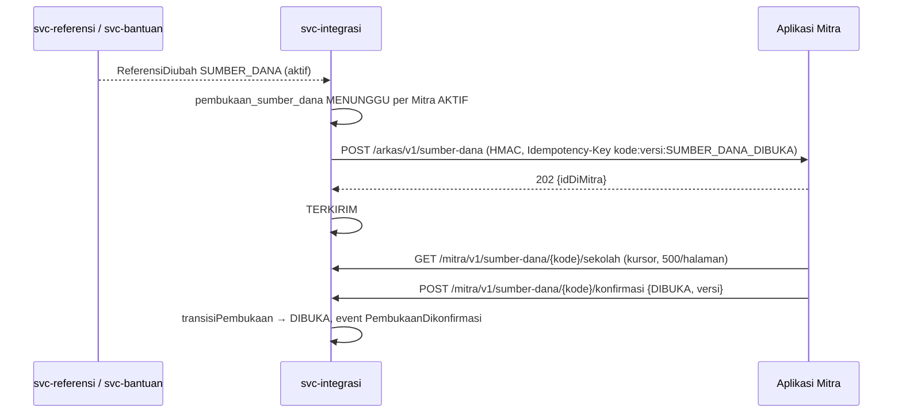
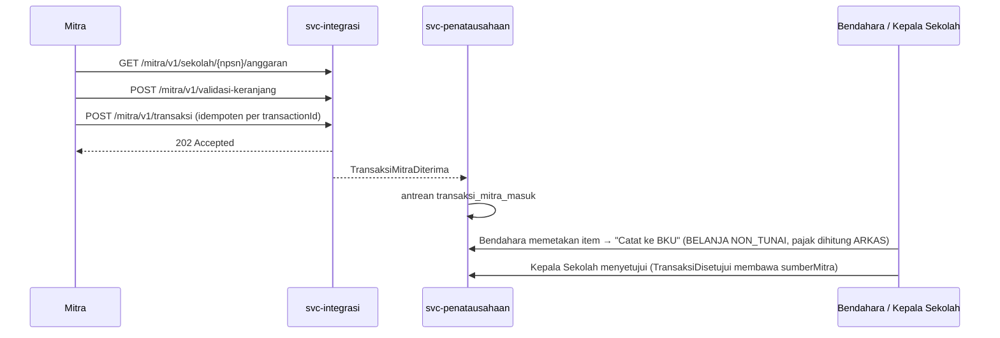
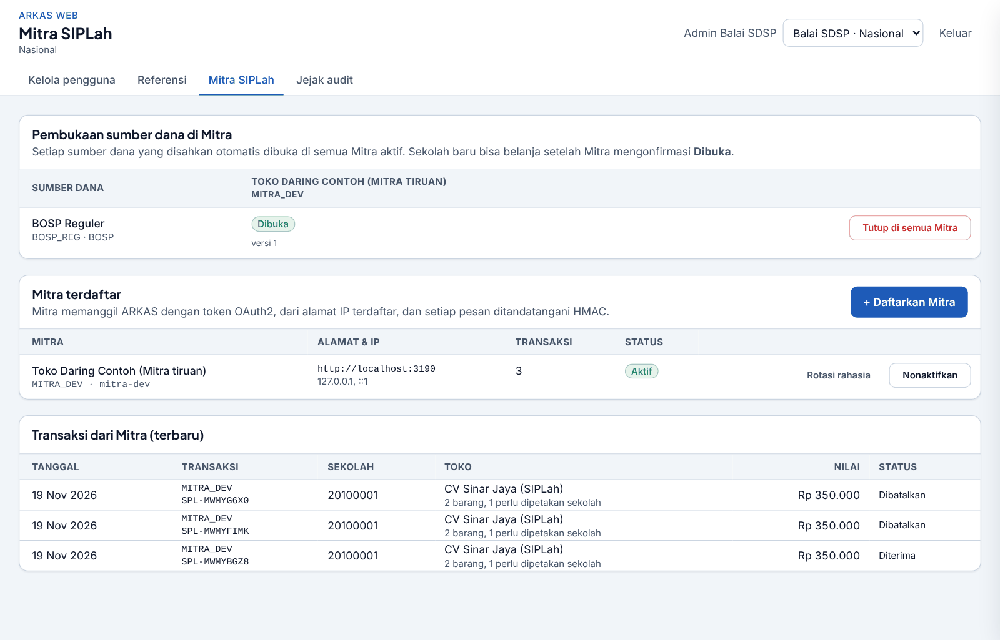
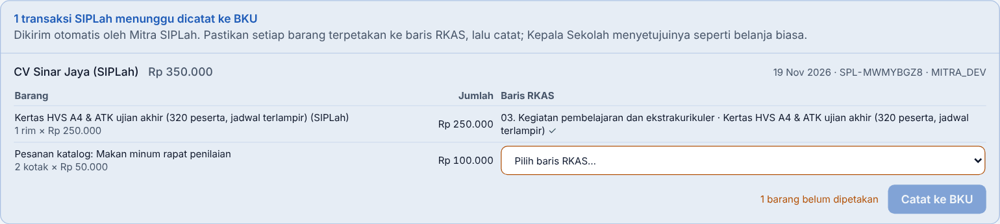

# svc-integrasi — Mitra SIPLah dua sisi & pembukaan sumber dana

Layanan ini menjadi pintu ARKAS ke aplikasi **Mitra SIPLah** (toko daring belanja sekolah). Ada dua arah:
- **masuk** (`/mitra/v1/*`): Mitra mengambil anggaran sekolah, memvalidasi keranjang, mengirim transaksi, dan mengonfirmasi pembukaan;
- **keluar** (`{baseMitra}/arkas/v1/*`): ARKAS membuka dan menutup sumber dana di setiap Mitra.

| | |
|---|---|
| Port | 3109 |
| Basis data | `db_integrasi`, skema `integrasi` |
| Tabel | `mitra_siplah`, `pembukaan_sumber_dana`, `pembukaan_riwayat`, `transaksi_mitra`, `item_mitra`, proyeksi `rkas_anggaran_mitra`, `sekolah_berhak_lokal`, `sumber_dana_lokal`, `ref_sekolah_lokal`, outbox/inbox |
| Mengonsumsi | `ReferensiDiubah` (sumber dana, sekolah), `KertasKerjaDisahkan` |
| Menerbitkan | `TransaksiMitraDiterima`, `TransaksiMitraDibatalkan`, `PembukaanDikonfirmasi` |
| Use case | UC-34 daftar Mitra, UC-35 anggaran/keranjang/transaksi, UC-37 buka, UC-38 konfirmasi & sekolah berhak, UC-39 pantau/kirim ulang/tutup |

## Pembukaan sumber dana (SK-08)



- Siklus status ditulis sebagai fungsi murni `transisiPembukaan` (`packages/aturan/src/status-pembukaan.ts`):

| Dari | Aksi | Ke |
|---|---|---|
| MENUNGGU | kirim berhasil | TERKIRIM (atau DITUTUP bila yang dikirim adalah penutupan) |
| MENUNGGU | gagal sampai batas percobaan | GAGAL |
| TERKIRIM | konfirmasi Mitra, versi sama | DIBUKA atau GAGAL |
| apa pun (BUKA) | data sumber dana berubah | MENUNGGU, versi + 1 |
| GAGAL | kirim ulang oleh Balai | MENUNGGU |
| apa pun | tutup | MENUNGGU (target TUTUP), versi + 1 |

- Konfirmasi untuk versi lama ditolak **409 `VERSI_USANG`**. Konfirmasi ganda untuk versi yang sama aman (idempoten).
- Pekerja `PengirimPembukaan` memakai `FOR UPDATE SKIP LOCKED` (aman untuk banyak pod), dengan backoff eksponensial. Setelah `PENGIRIM_MAKS_PERCOBAAN` kali gagal, statusnya menjadi **GAGAL** dan muncul tombol *Kirim ulang* di layar Balai.
- Mitra **hanya boleh menerima belanja** untuk sumber dana yang sudah dikonfirmasi **DIBUKA** (`bolehBelanja`); selain itu ditolak `SUMBER_DANA_BELUM_DIBUKA`.
- Sumber dana yang dinonaktifkan Balai (`ReferensiDiubah aktif=false`), atau ditutup lewat `POST /sumber-dana/{kode}/tutup`, dikirim sebagai **DITUTUP** ke semua Mitra.

## Belanja di Mitra sampai BKU (SK-04)



- **Anggaran untuk Mitra** dilayani dari proyeksi lokal `rkas_anggaran_mitra`, tanpa memanggil svc-perencanaan. Sisa = anggaran − belanja Mitra yang diterima. Pergeseran RKAS tetap dihitung benar lewat `akar_baris_id`.
- **Idempotensi** `(mitra_kode, transaction_id)`: kiriman ulang yang identik dijawab 200 `Idempotent-Replayed`; isi berbeda dijawab **409 `TRANSACTION_ID_DIPAKAI_ULANG`**. Transaksi dan itemnya final (trigger menolak UPDATE/DELETE isi).
- **Item tanpa ID baris RKAS** tetap diterima. Bendahara memetakannya di panel *Transaksi SIPLah* (UC-12); pilihan berkode rekening sama ditandai ★.
- **Kompensasi**: `POST /mitra/v1/transaksi/{id}/status` (DIBATALKAN/RETUR) → `TransaksiMitraDibatalkan`. Yang belum dicatat langsung dibatalkan. Yang sudah dicatat ditandai, supaya Kepala Sekolah menolaknya, atau, bila sudah disetujui, pengembalian dana dicatat sebagai penerimaan.

## Keamanan `/mitra/v1` (12.4)

| Kontrol | Penerapan |
|---|---|
| OAuth2 client credentials | `POST /mitra/v1/oauth/token`; token HS256 berumur 10 menit (`MITRA_TOKEN_SECRET`). `client_secret` hanya disimpan sebagai hash SHA-256 dan dibandingkan dalam waktu konstan |
| Daftar IP | `ip_diizinkan` per Mitra; di balik API Gateway atur `TRUST_PROXY` |
| HMAC-SHA256 | `X-Signature = HMAC(rahasia, "{X-Timestamp}.{body mentah}")`, umur pesan ≤ 5 menit, `timingSafeEqual` |
| Pesan keluar | ARKAS menandatangani kiriman ke Mitra dengan rahasia HMAC yang sama |
| Rahasia | ditampilkan **sekali** saat pendaftaran/rotasi; tidak ikut di daftar Mitra maupun jejak audit |

## Tampilan

- **Balai SDSP → Mitra SIPLah**: matriks pembukaan (sumber dana × Mitra) yang diperbarui otomatis, kirim ulang, tutup di semua Mitra, daftarkan Mitra (kredensial tampil sekali), rotasi rahasia, nonaktifkan, dan transaksi Mitra terbaru. Pemantau hanya bisa membaca.
- **Bendahara/Kepala Sekolah → BKU**: panel *Transaksi SIPLah* untuk memetakan dan mencatat, beserta peringatan bila pesanan dibatalkan atau diretur.




## Mitra tiruan (dev)

`scripts/mitra-tiruan.mjs` memakai kredensial dari `db/svc-integrasi/migrations/90_seed_dev.sql`:

```bash
node scripts/mitra-tiruan.mjs server
```
Perintah di atas menjalankan Mitra di :3190. Mitra menerima pembukaan lalu otomatis mengonfirmasi DIBUKA (`AUTO_KONFIRMASI=0` untuk mematikan konfirmasi otomatis).
```bash
node scripts/mitra-tiruan.mjs belanja 20100001
```
```bash
node scripts/mitra-tiruan.mjs batal SPL-XXXX RETUR
```

## Pengujian

- `apps/svc-integrasi/test/integrasi.e2e.spec.ts` (11 uji, memakai server Mitra HTTP sungguhan di dalam uji): pembukaan → kiriman bertanda tangan → konfirmasi (dan versi usang); token, tanda tangan salah, pesan kedaluwarsa, body diubah, IP, Mitra nonaktif; anggaran & validasi keranjang; transaksi idempoten; pergeseran RKAS; pembatalan; daftar Mitra; gagal → kirim ulang; penutupan.
- `apps/svc-penatausahaan/test/transaksi-mitra.e2e.spec.ts` (3 uji): antrean, pemetaan wajib, BELANJA dengan pajak ARKAS, `sumberMitra` di TransaksiDisetujui, kompensasi.
- `packages/aturan/test/pembukaan-hpp.spec.ts`: `transisiPembukaan`.
- `apps/web/e2e/siplah.e2e.ts` (2 uji UI): Mitra tiruan mengirim → Bendahara memetakan & mencatat → Kepala Sekolah melihatnya; matriks Balai.

## Belum dikerjakan

Rekonsiliasi harian `GET {baseMitra}/arkas/v1/transaksi` (UC-36); pengiriman RKAS ke SIPD dan sinkron Dapodik/BOSP (UC-41); notifikasi; enkripsi KMS untuk rahasia HMAC; anggaran Mitra yang juga dikurangi belanja non-SIPLah.
