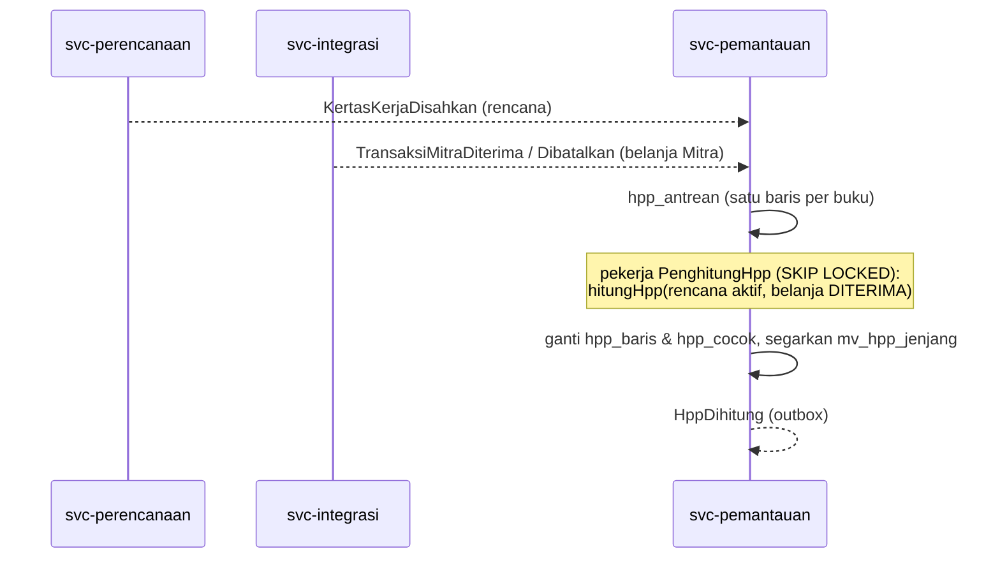
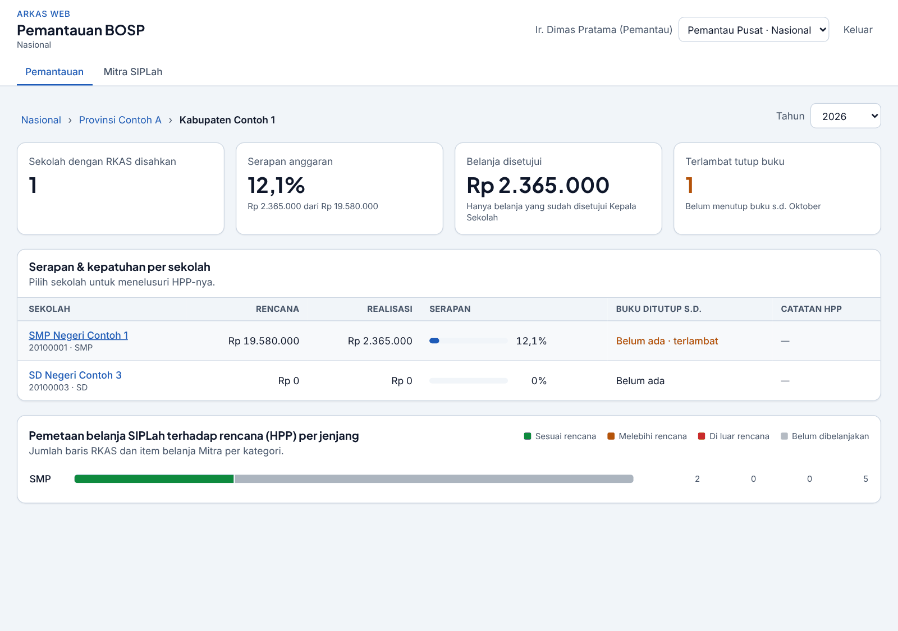
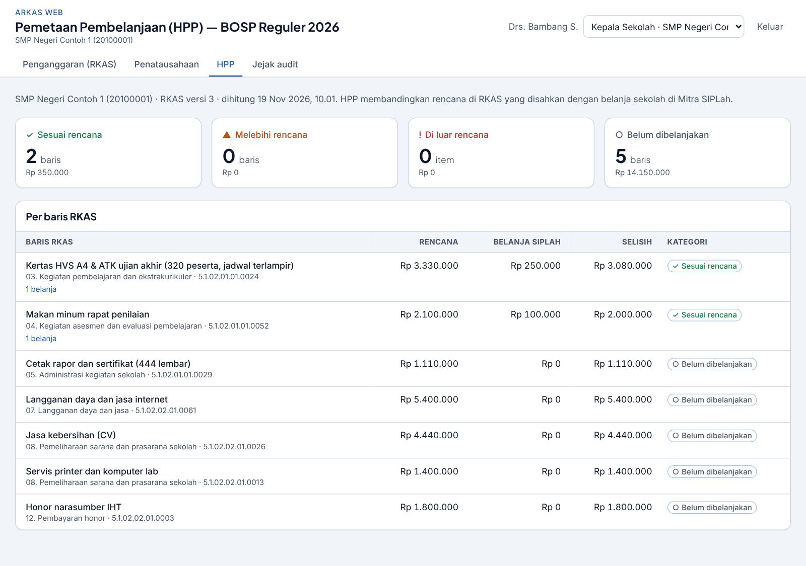

# svc-pemantauan — HPP, serapan & kepatuhan

Layanan baca-saja yang merangkum kejadian dari layanan lain menjadi dua hal:
- **HPP (Halaman Pemetaan Pembelanjaan)**: membandingkan rencana di RKAS yang disahkan dengan belanja sekolah di Mitra SIPLah;
- **dasbor serapan & kepatuhan** nasional/wilayah: berapa yang sudah dibelanjakan dan siapa yang terlambat menutup buku.

| | |
|---|---|
| Port | 3110 |
| Basis data | `db_pemantauan`, skema `pemantauan` |
| Tabel hasil | `hpp_baris`, `hpp_cocok`, `hpp_ringkas`, materialized view `mv_hpp_jenjang` |
| Proyeksi lokal | `rencana_sah_lokal`, `belanja_mitra_lokal`, `realisasi_lokal`, `periode_lokal`, `pembukaan_lokal`, `ref_sekolah_lokal`, `ref_wilayah_lokal` |
| Mengonsumsi | `KertasKerjaDisahkan`, `TransaksiMitraDiterima/Dibatalkan`, `TransaksiDisetujui`, `PeriodeDitutup`, `PembukaanDikonfirmasi`, `ReferensiDiubah` |
| Menerbitkan | `HppDihitung` |
| Use case | UC-30 memantau serapan & kepatuhan, UC-33 menjalankan & menelusuri HPP |

## HPP (SK-11)

Fungsi murni `hitungHpp` (`packages/aturan/src/kategori-hpp.ts`) mencocokkan item belanja ke baris RKAS:
1. item yang membawa ID baris RKAS → baris itu. Baris versi lama dialihkan ke baris penerusnya lewat `akar_baris_id`, jadi pergeseran RKAS tidak merusak HPP;
2. item tanpa ID tetapi kode rekeningnya ada di RKAS → baris sekode yang sisanya terbesar;
3. selain itu → **di luar rencana**.

| Kategori | Arti |
|---|---|
| Sesuai rencana | belanja > 0 dan ≤ rencana baris |
| Melebihi rencana | belanja > rencana baris |
| Di luar rencana | item belanja yang tidak ada di RKAS |
| Belum dibelanjakan | baris rencana tanpa belanja |

Pembatalan/retur di Mitra langsung mengantrekan hitung ulang, sehingga kategorinya ikut terkoreksi (kompensasi saga).

## Dasbor serapan & kepatuhan (UC-30)

- **Serapan** = belanja yang **disetujui Kepala Sekolah** (`TransaksiDisetujui` jenis BELANJA, termasuk yang berasal dari SIPLah) ÷ total rencana RKAS yang disahkan.
- **Terlambat tutup buku**: sekolah ber-RKAS yang bulan terakhir ditutupnya (`PeriodeDitutup`) masih sebelum bulan lalu (tahun berjalan), atau sebelum Desember (tahun lampau).
- **Drill-down**: Nasional → provinsi → kabupaten/kota → sekolah → HPP sekolah. Agregat wilayah tidak memuat data pribadi.
- **Alarm**: pembukaan sumber dana yang **GAGAL** di Mitra (`PembukaanDikonfirmasi`) muncul di dasbor pusat.

### Cakupan (RLS `boleh_akses`)

| Peran | Yang terlihat |
|---|---|
| Pemantau Pusat, Balai SDSP, Auditor | semua (agregat HPP pusat dari `mv_hpp_jenjang`) |
| Admin/Verifikator Dinas | sekolah di wilayahnya; drill-down tidak bisa naik di atas wilayahnya |
| Operator, Bendahara, Kepala Sekolah, Komite | HPP sekolahnya sendiri (menu **HPP**) |

## API

| Metode & path | Isi |
|---|---|
| `GET /api/v1/dasbor/serapan?tahun&sumberDanaKode&induk` | serapan & keterlambatan per provinsi / kabupaten / sekolah |
| `GET /api/v1/dasbor/hpp?tahun&sumberDanaKode` | distribusi kategori HPP per jenjang + alarm pembukaan gagal |
| `GET /api/v1/hpp/sekolah/{npsn}?tahun&sumberDanaKode` | ringkasan, kategori per baris, dan item Mitra yang dicocokkan (beserta caranya) |

## Tampilan

## Pengujian

- `apps/svc-pemantauan/test/pemantauan.e2e.spec.ts` (5 uji): HPP 4 kategori lewat pekerja asinkron dan HppDihitung; kompensasi retur; serapan & keterlambatan berjenjang; Dinas dikunci ke wilayah; agregat MV & alarm.
- `packages/aturan/test/pembukaan-hpp.spec.ts`: `hitungHpp`.
- `apps/web/e2e/pemantauan.e2e.ts` (2 uji UI).

## Belum dikerjakan

Peta koroplet (perlu data geometri wilayah); ekspor CSV/Excel; penyaring jenjang & sumber dana selain BOSP Reguler di layar; konsumen `HppDihitung` (notifikasi).
