Halo! Tutorial ini nemenin kamu pakai ARKAS Web dari klik pertama sampai laporan bulanan beres. Tiap langkah ada gambarnya, dan bagian yang perlu kamu klik ditandai **kotak merah**.

**Isi tutorial ini**

1. Kenalan dulu, yuk (termasuk cara masuk)
2. Tutorial Operator: 9 langkah
3. Tutorial Kepala Sekolah: 6 langkah
4. Tutorial Bendahara: 7 langkah, plus kalau catatan ditolak
5. Tutorial Komite Sekolah: 5 langkah
6. Kalau ada yang macet: pesan yang sering muncul dan tanya-jawab

# Kenalan dulu, yuk

Di ARKAS Web, tiap orang punya tugas sendiri-sendiri, dan tombol yang muncul di layar menyesuaikan tugasmu. Jadi jangan heran kalau layar Bendahara beda dengan layar Kepala Sekolah, ya.

| Kamu sebagai... | Tugas utamamu | Baca bagian |
|---|---|---|
| Operator | Menyusun RKAS dan mendaftarkan pengguna sekolah | Tutorial Operator |
| Kepala Sekolah | Mengajukan RKAS, menyetujui transaksi, menutup buku, tanda tangan laporan | Tutorial Kepala Sekolah |
| Bendahara | Mencatat uang masuk-keluar, menyetor pajak, mengajukan tutup buku | Tutorial Bendahara |
| Komite Sekolah | Memantau RKAS, buku kas, dan laporan (cuma lihat, nggak bisa mengubah) | Tutorial Komite Sekolah |

Alurnya kira-kira begini: **Operator menyusun RKAS → Kepala Sekolah mengajukan → Dinas mengesahkan → Bendahara mencatat transaksi → Kepala Sekolah menyetujui → tiap akhir bulan buku ditutup → laporan PDF jadi otomatis.**

**Cara baca tutorial ini:** ikuti langkahnya berurutan. Di setiap gambar, kotak merah menunjukkan tombol atau kolom yang perlu kamu klik atau isi, dan label merahnya bilang apa yang harus dilakukan.

## Cara masuk (berlaku untuk semua)

1. Buka alamat ARKAS Web sekolahmu di Chrome atau browser lain.
2. Klik **Masuk dengan SSO**, lalu masuk pakai akun SSO kamu (email yang didaftarkan Operator atau Dinas).

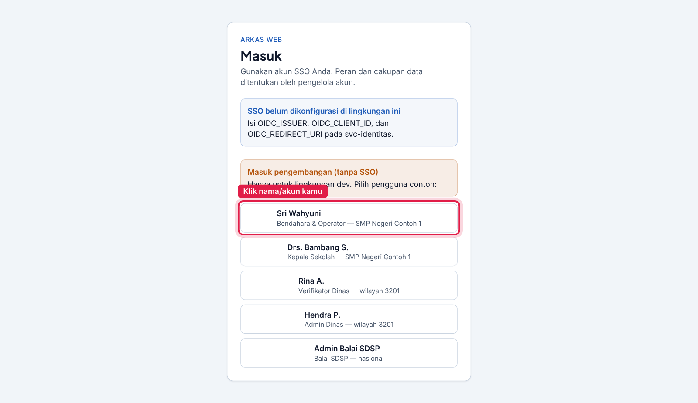{width=17cm}

*Gambar ini dari lingkungan uji coba, jadi yang muncul daftar akun contoh. Di sekolahmu nanti yang ada tombol Masuk dengan SSO.*

3. Kalau kamu pegang lebih dari satu tugas (misalnya Bendahara sekaligus Operator), kamu akan diminta memilih mau masuk sebagai apa dulu.

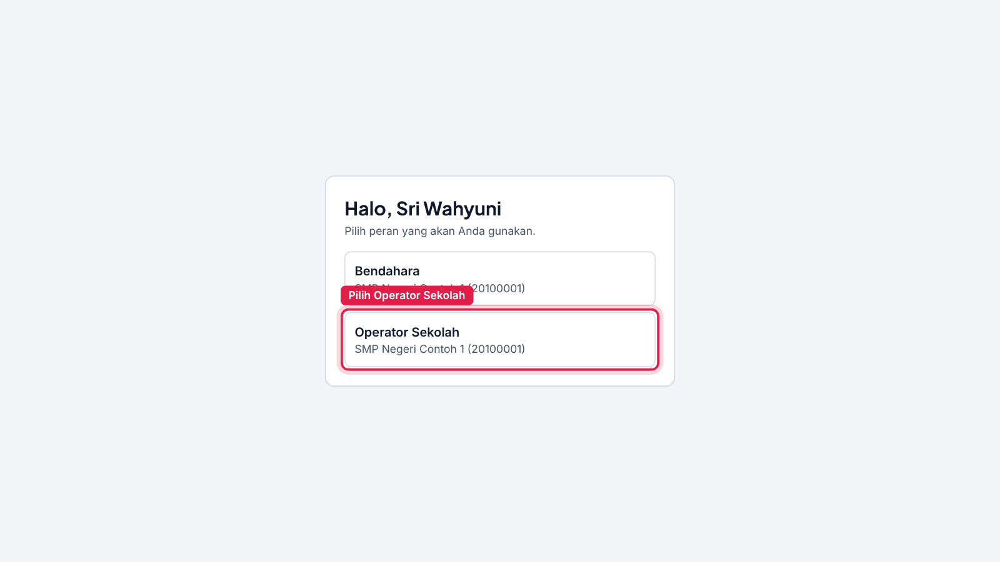{width=17cm}

4. Mau ganti tugas di tengah jalan? Pakai kotak pilihan di pojok kanan atas. Udah selesai? Klik **Keluar** di sebelahnya, apalagi kalau pakai komputer bersama.

# Tutorial Operator

Tugas besarmu cuma dua: **menyusun RKAS** sampai lolos aturan juknis, dan **mendaftarkan warga sekolah** yang perlu akses. Santai, ikuti saja langkahnya.

## Langkah 1: Masuk sebagai Operator

Masuk dulu seperti di bagian *Cara masuk*. Kalau ditanya mau masuk sebagai apa, pilih **Operator Sekolah**.

## Langkah 2: Aktifkan kertas kerja RKAS

Tiap awal tahun anggaran, kertas kerja masih kosong. Klik **Aktifkan kertas kerja**. Cukup sekali setahun, kok.

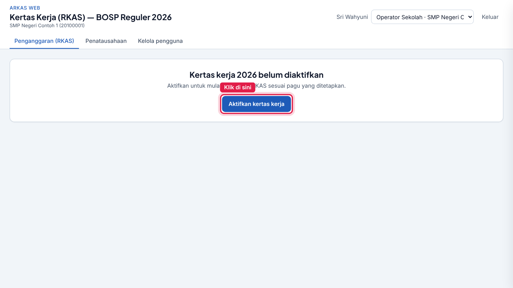{width=17cm}

## Langkah 3: Cek pagu, lalu tambah baris

Setelah aktif, kamu langsung lihat **pagu** sekolahmu di kiri: itu batas total anggaran setahun. Sekarang klik **+ Tambah baris** untuk mulai mengisi rencana belanja.

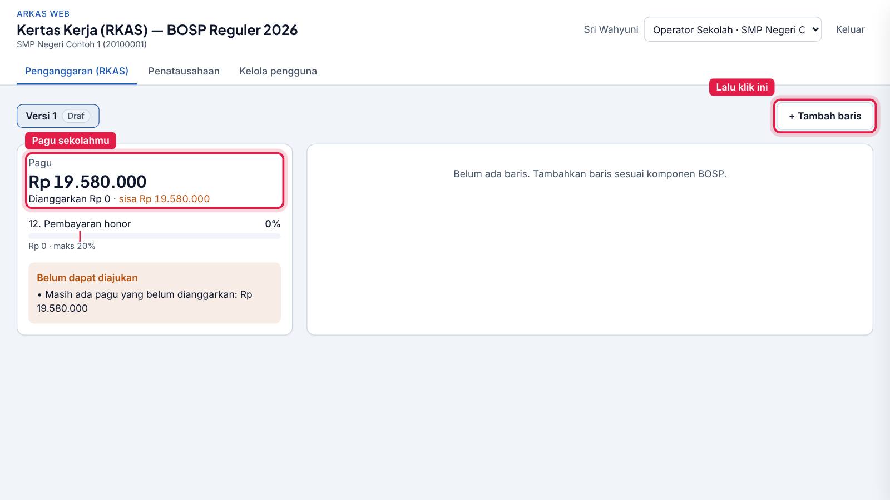{width=17cm}

## Langkah 4: Isi baris anggaran

Akan muncul laci di sebelah kanan. Isi dari atas ke bawah:

1. **Komponen BOSP**: pilih kegiatannya, misalnya *03. Kegiatan pembelajaran dan ekstrakurikuler*.
2. **Kode rekening**: misalnya `5.1.02.01.01.0024` untuk alat tulis kantor.
3. **Uraian**, **Volume**, **Satuan**, dan **Harga satuan**.

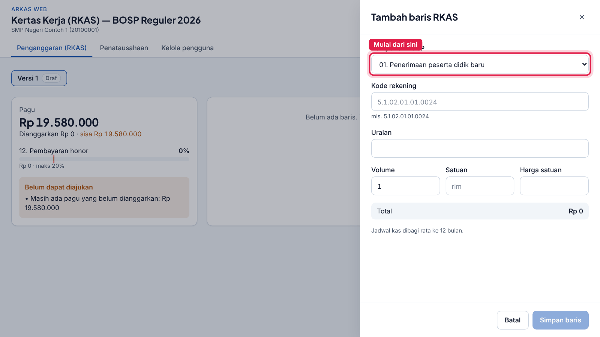{width=17cm}

Totalnya dihitung otomatis. Kalau sudah benar, klik **Simpan baris**.

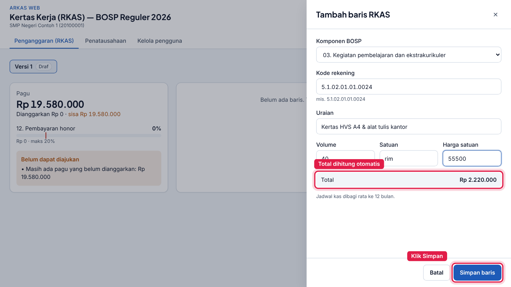{width=17cm}

## Langkah 5: Perhatikan kotak kuning

Selama pagu belum habis teranggarkan, ada kotak kuning **Belum dapat diajukan** yang memberi tahu sisa pagunya. Tenang, itu normal. Tambah terus barisnya sampai sisa pagu jadi Rp 0.

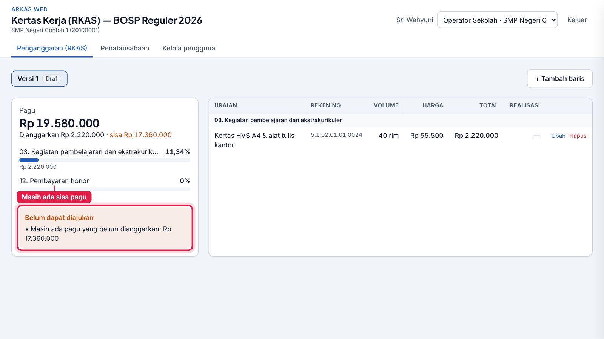{width=17cm}

## Langkah 6: Pastikan kotak hijau muncul

Kalau semua baris sudah lengkap dan sesuai aturan juknis, kotaknya berubah jadi hijau **Memenuhi aturan juknis**. Batas komponen, misalnya honor maksimal 20%, ditandai garis merah di bilahnya. Sekarang kabari Kepala Sekolah bahwa RKAS siap diajukan.

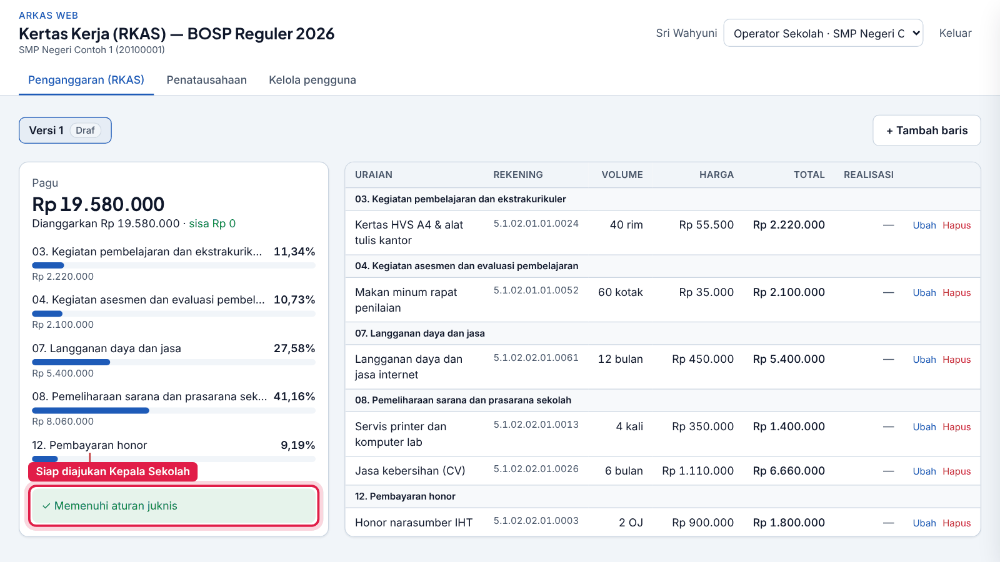{width=17cm}

## Langkah 7: Kalau RKAS dikembalikan Dinas

Kadang Dinas mengembalikan RKAS untuk diperbaiki. Nggak apa-apa! Kamu akan lihat kotak **Dikembalikan Verifikator Dinas** berisi alasannya, plus **Catatan Dinas** di baris yang perlu dibenahi.

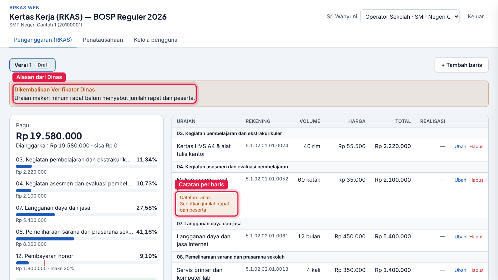{width=17cm}

Klik **Ubah** di baris yang diberi catatan.

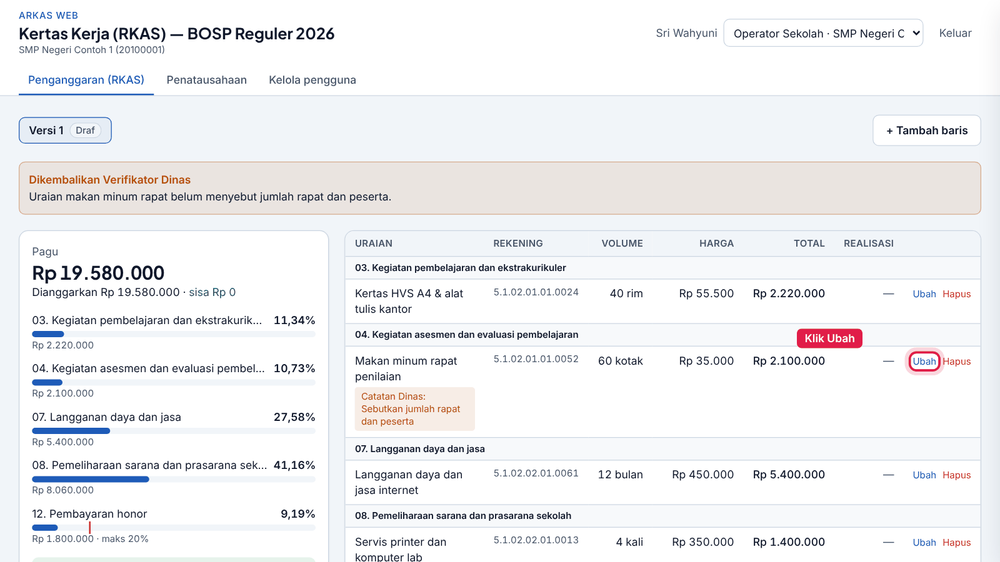{width=17cm}

Perbaiki sesuai catatan (di contoh ini, uraiannya dilengkapi jumlah rapat dan pesertanya), lalu klik **Simpan baris**. Setelah itu minta Kepala Sekolah mengajukan ulang.

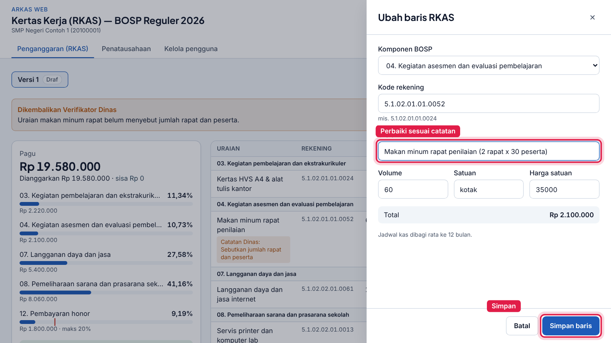{width=17cm}

## Langkah 8: RKAS disahkan, beres!

Kalau Dinas sudah setuju, status versi berubah jadi **Disahkan**. Di bagian **Riwayat** kamu bisa lihat jejaknya: kapan diajukan, dikembalikan, dan disahkan. Mulai sekarang Bendahara bisa mencatat transaksi.

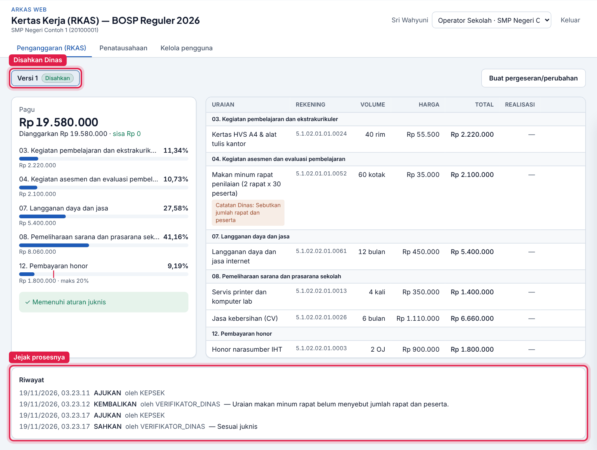{width=17cm}

*Mau mengubah RKAS yang sudah disahkan? Pakai tombol **Buat pergeseran/perubahan**. Versi lama tetap tersimpan.*

## Langkah 9: Daftarkan pengguna baru (misalnya Komite)

Buka menu **Kelola pengguna**, lalu klik **+ Tambah pengguna**. Sebagai Operator, kamu bisa memberi tugas Bendahara, Kepala Sekolah, atau Komite Sekolah.

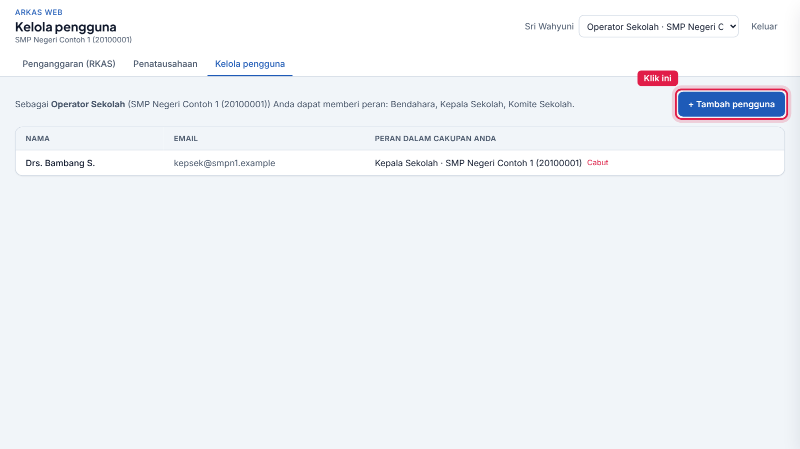{width=17cm}

Isi **email SSO** orangnya (harus persis sama dengan akun SSO yang dia pakai), nama lengkap, lalu pilih **Peran**. NPSN sekolah terisi otomatis. Klik **Simpan**.

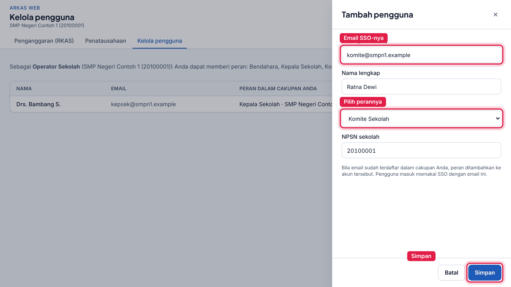{width=17cm}

Selesai! Orangnya sekarang bisa masuk pakai SSO. Kalau tugasnya sudah berakhir, klik **Cabut** di samping perannya.

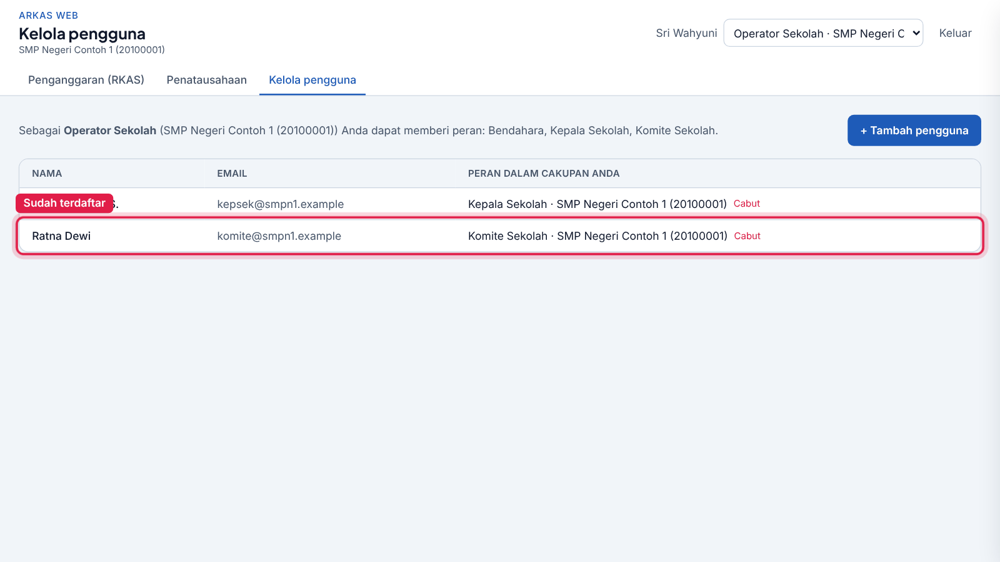{width=17cm}

# Tutorial Kepala Sekolah

Bapak/Ibu Kepala Sekolah nggak perlu mencatat apa-apa. Tugasnya **memeriksa dan memutuskan**: setuju atau tolak. Setiap keputusan tercatat atas nama Bapak/Ibu dan nggak bisa dibatalkan, jadi cek dulu baik-baik ya.

## Langkah 1: Masuk

Masuk pakai akun SSO Kepala Sekolah. Bapak/Ibu langsung dibawa ke halaman **Penatausahaan** (Buku Kas Umum).

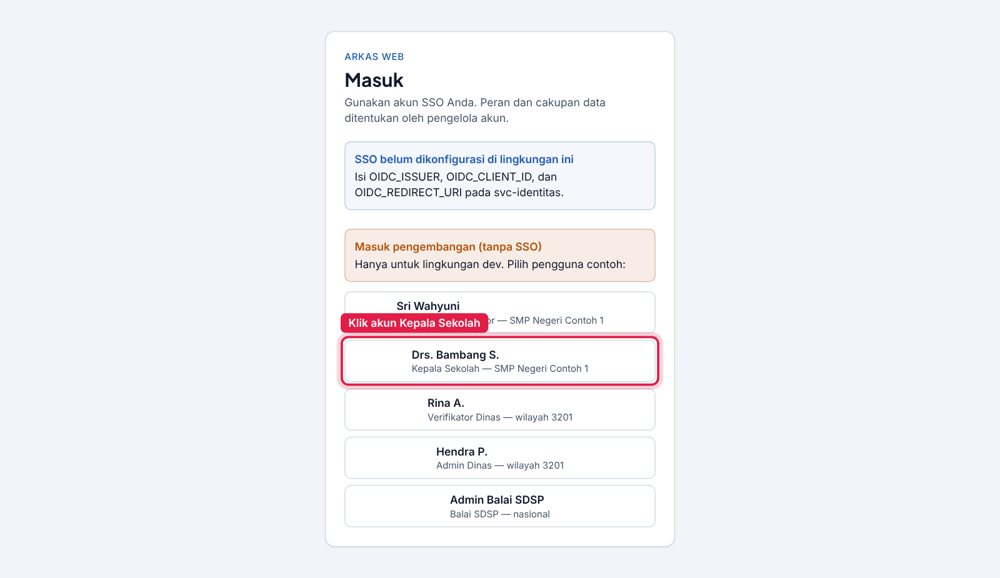{width=17cm}

## Langkah 2: Ajukan RKAS ke Dinas

Setelah Operator bilang RKAS siap, buka menu **Penganggaran (RKAS)**. Pastikan ada kotak hijau *Memenuhi aturan juknis*, lalu klik **Ajukan ke Dinas**. Akan muncul kotak konfirmasi dari browser: klik **OK**.

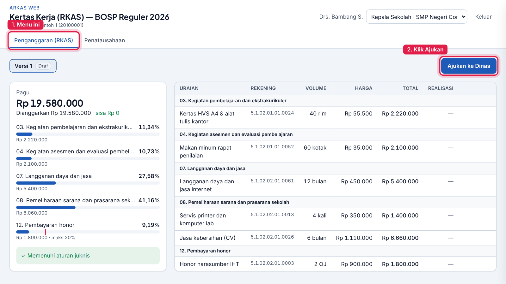{width=17cm}

Status versi berubah jadi **Diajukan ke Dinas**. Selama ditelaah, RKAS terkunci dan nggak bisa diubah siapa pun. Kalau Dinas mengembalikan, Operator memperbaikinya, lalu Bapak/Ibu tinggal klik **Ajukan ke Dinas** lagi.

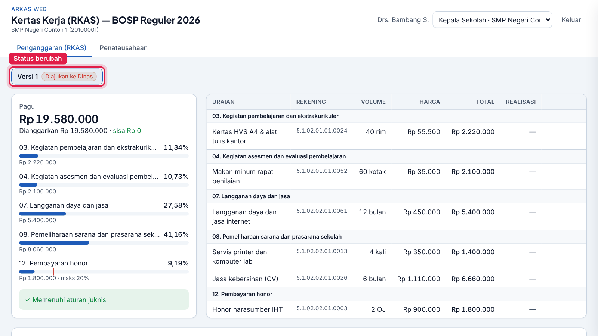{width=17cm}

## Langkah 3: Setujui transaksi

Setiap kali Bendahara mencatat sesuatu, di halaman **Penatausahaan** muncul tulisan oranye *N transaksi menunggu persetujuan Anda*. Cek uraian, nilai, dan nomor buktinya. Kalau cocok, klik **Setujui**. Uangnya baru masuk ke saldo setelah Bapak/Ibu setujui.

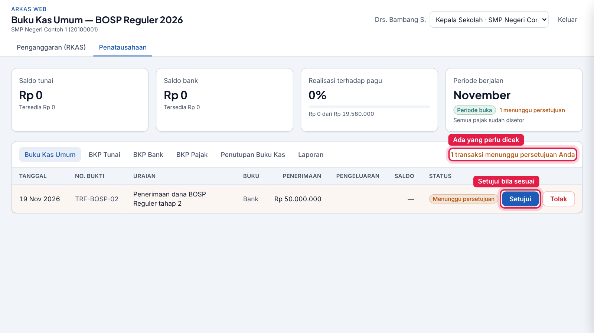{width=17cm}

Untuk belanja, pajak yang dipungut ikut tampil di baris bawahnya (misalnya *Pungut SSPD*). Jadi Bapak/Ibu bisa sekalian cek pajaknya.

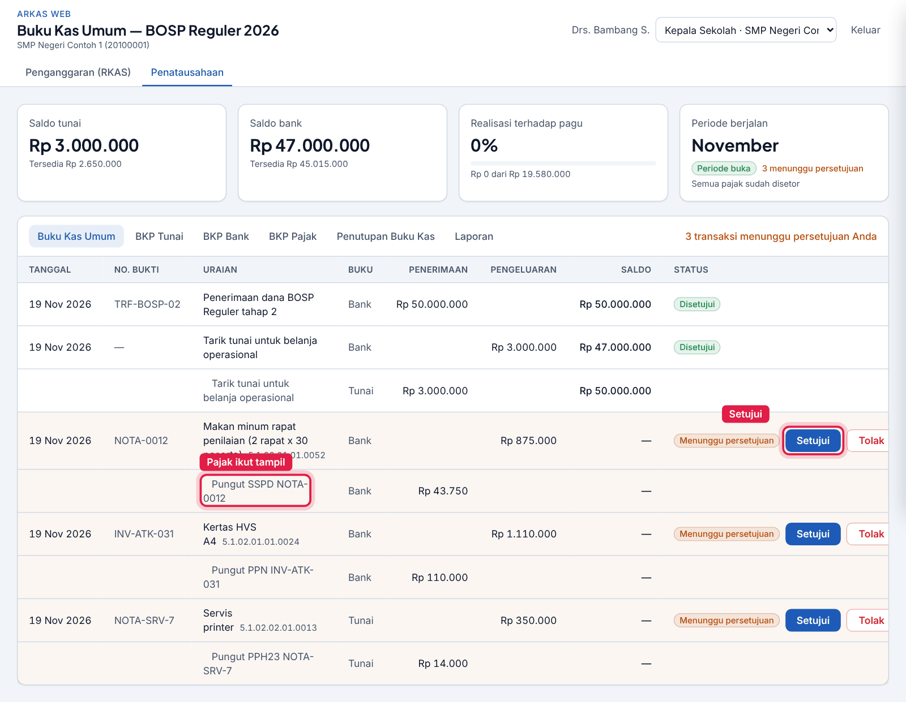{width=17cm}

## Langkah 4: Tolak kalau ada yang janggal

Nota belum lengkap? Nilainya aneh? Klik **Tolak**, lalu tulis alasannya di kotak yang muncul (wajib diisi). Transaksi yang ditolak nggak masuk saldo dan pajaknya otomatis batal.

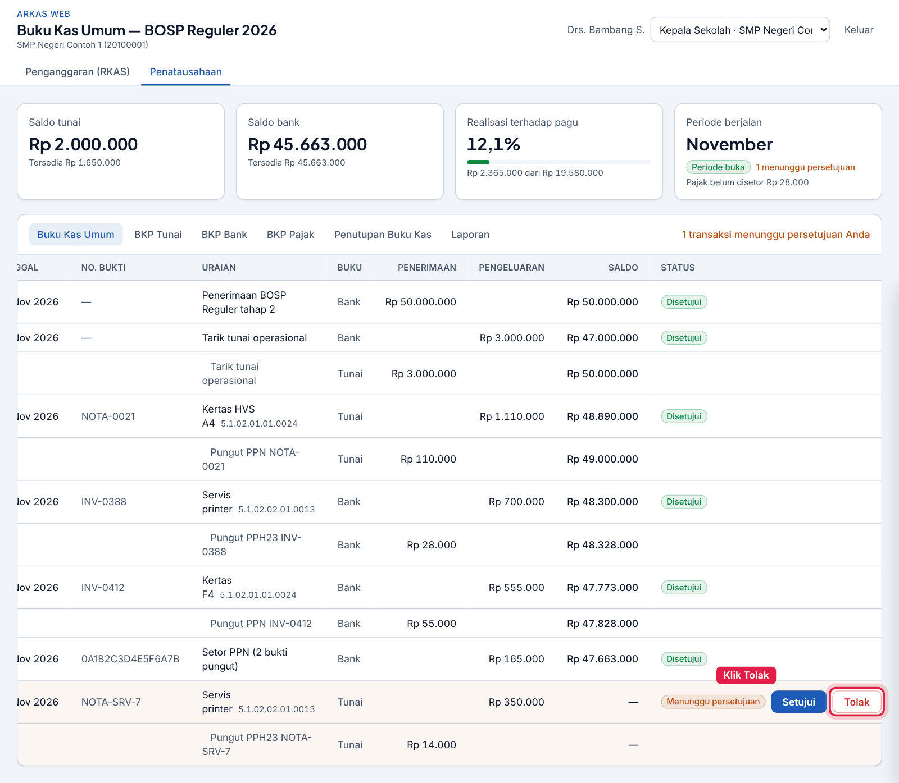{width=17cm}

Setelah ditolak, transaksinya keluar dari Buku Kas Umum dan pindah ke kotak merah **transaksi ditolak** di atas tabel, lengkap dengan alasan yang Bapak/Ibu tulis. Bendahara melihat kotak yang sama, jadi nggak perlu repot menjelaskan ulang.

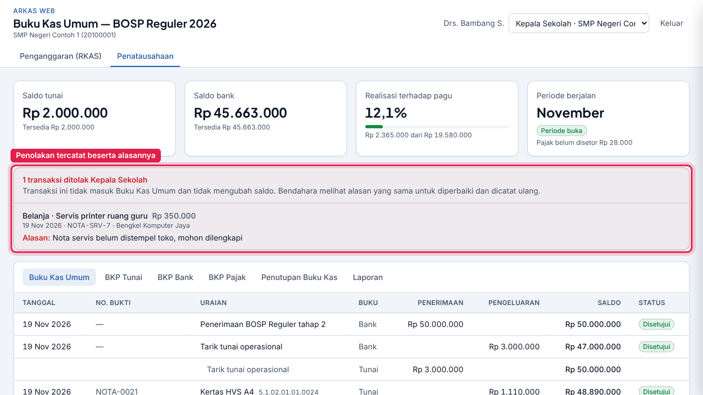{width=17cm}

## Langkah 5: Periksa dan setujui tutup buku bulanan

Tiap akhir bulan, Bendahara mengajukan tutup buku. Buka tab **Penutupan Buku Kas**. Di kanan ada **Berita acara pemeriksaan kas**: saldo buku dibandingkan dengan rekening koran dan uang tunai fisik. Idealnya selisihnya Rp 0 (warna hijau). Kalau ada selisih, pastikan penjelasan Bendahara masuk akal.

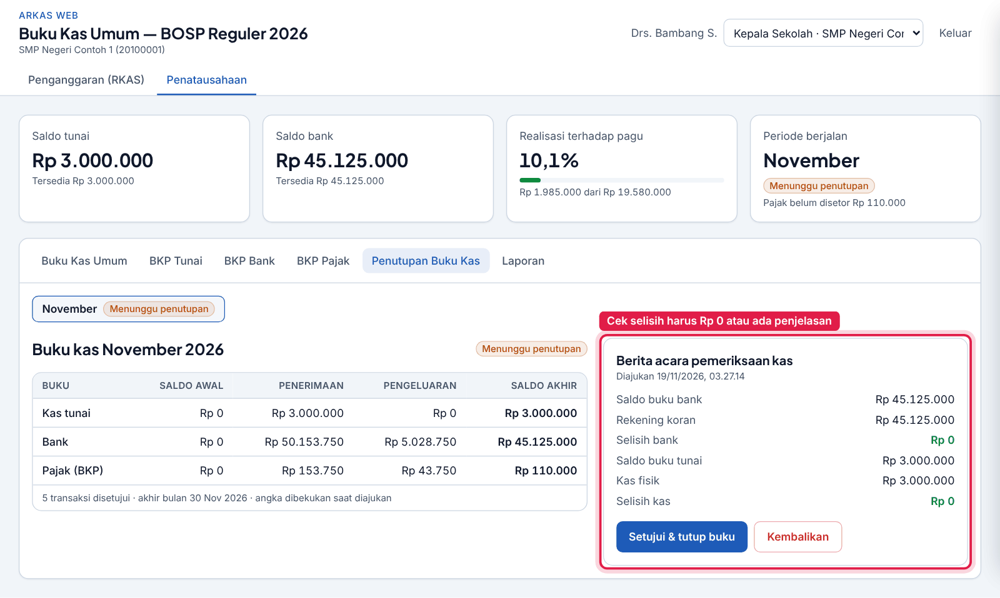{width=17cm}

Kalau sudah oke, klik **Setujui & tutup buku**. Bulan itu dikunci permanen. Kalau masih ada yang salah, klik **Kembalikan** dan tulis alasannya.

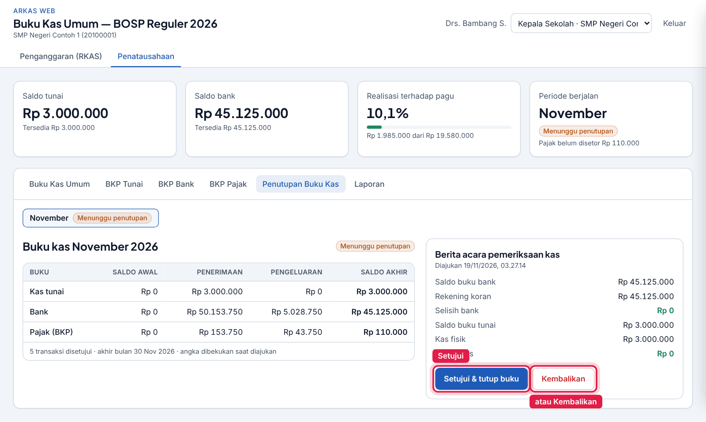{width=17cm}

## Langkah 6: Baca dan tanda tangani laporan

Beberapa detik setelah buku ditutup, laporan BKU bulanan jadi otomatis. Buka tab **Laporan**, klik **Lihat PDF** untuk membacanya dulu, lalu klik **Tandatangani**.

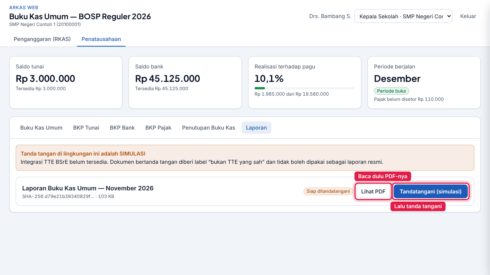{width=17cm}

Beginilah isi PDF-nya: ringkasan per buku dan seluruh transaksi bulan itu.

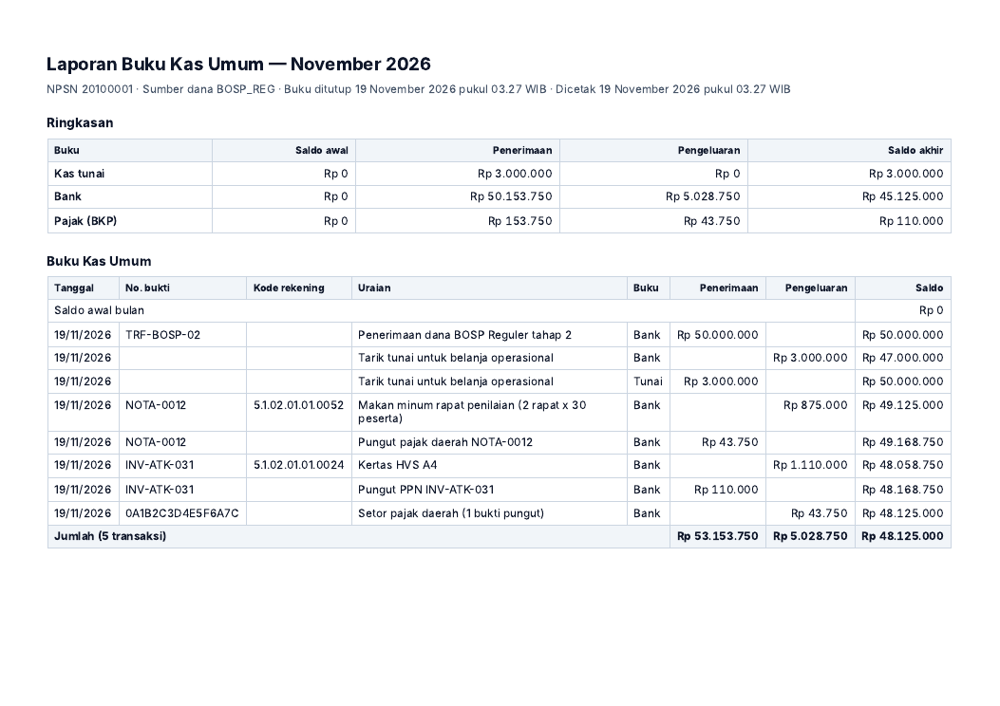{width=17cm}

Setelah ditandatangani, statusnya jadi **Ditandatangani**. Beres untuk bulan ini!

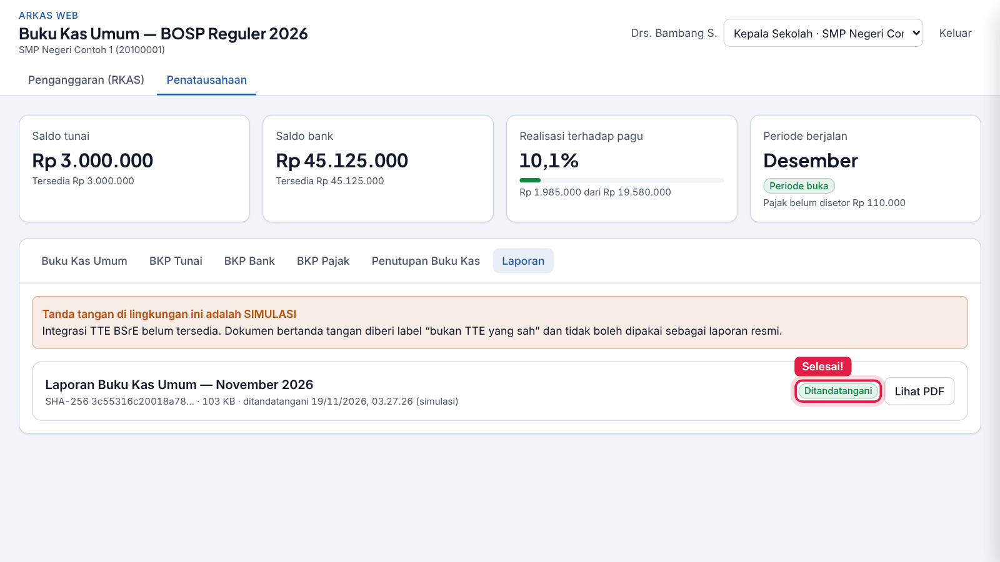{width=17cm}

*Saat ini tanda tangannya masih simulasi (tombolnya bertuliskan "Tandatangani (simulasi)"), belum memakai TTE resmi BSrE.*

# Tutorial Bendahara

Nah, ini bagian paling seru. Kamu yang mencatat semua uang masuk dan keluar. Ingat satu aturan emas: **semua catatanmu baru dianggap sah setelah disetujui Kepala Sekolah.** Sebelum itu, statusnya *Menunggu persetujuan* dan belum mengubah saldo.

## Langkah 1: Tunggu RKAS disahkan

Masuk sebagai **Bendahara**. Kalau RKAS belum disahkan Dinas, kamu akan lihat kotak *RKAS belum disahkan* dan tombol-tombol pencatatan belum muncul. Sabar dulu ya, buku kas otomatis terbuka begitu RKAS disahkan.

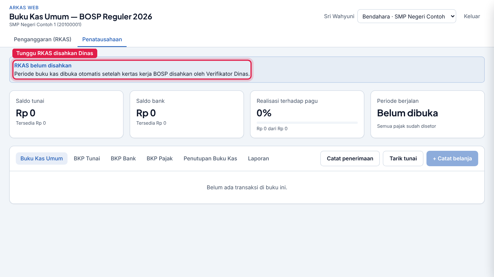{width=17cm}

## Langkah 2: Catat penerimaan dana BOSP

Begitu buku kas terbuka, saldo masih Rp 0. Hal pertama yang dicatat adalah dana yang masuk ke rekening sekolah. Klik **Catat penerimaan**.

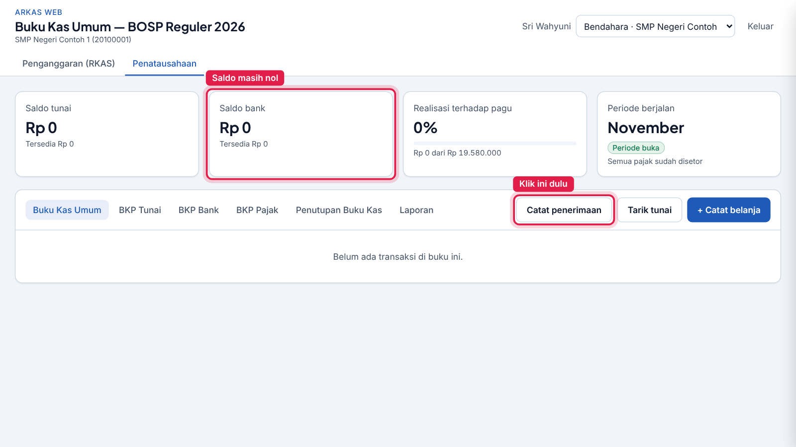{width=17cm}

Isi uraian, **Nilai (Rp)** sesuai rekening koran, dan nomor bukti transfer (boleh dikosongkan). Klik **Simpan**.

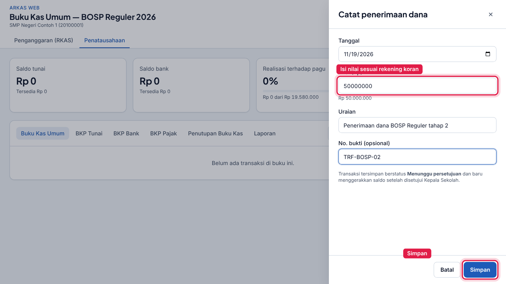{width=17cm}

Catatanmu muncul dengan status **Menunggu persetujuan**. Minta Kepala Sekolah menyetujuinya, ya.

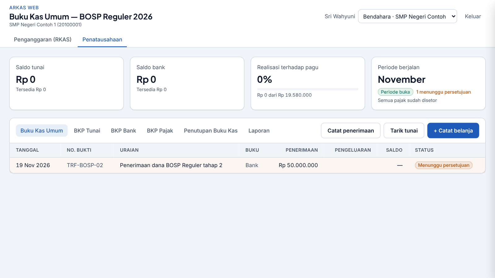{width=17cm}

## Langkah 3: Tarik tunai untuk belanja tunai

Setelah penerimaan disetujui, saldo bank bertambah. Kalau mau belanja pakai uang tunai, tarik dulu dari rekening: klik **Tarik tunai**.

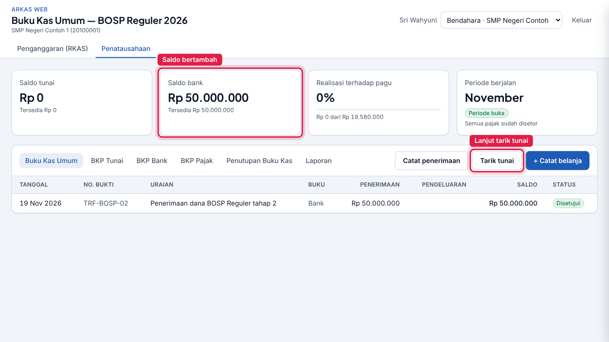{width=17cm}

Isi nilai yang ditarik, lalu **Simpan**. Ini juga perlu disetujui Kepala Sekolah sebelum saldo tunai bertambah.

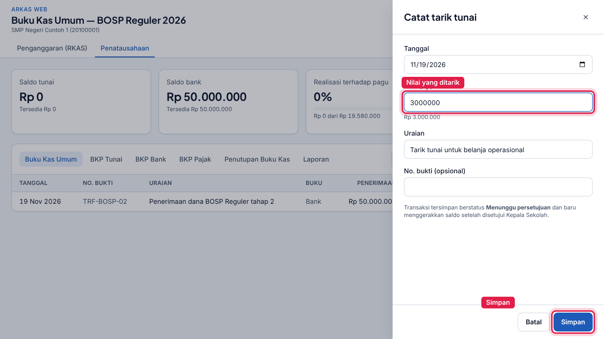{width=17cm}

*Tips: tarik tunai baru bisa disimpan kalau saldo bank cukup. Jadi pastikan penerimaan sudah disetujui dulu.*

## Langkah 4: Catat belanja (3 langkah)

Ini yang paling sering kamu lakukan. Klik **+ Catat belanja**.

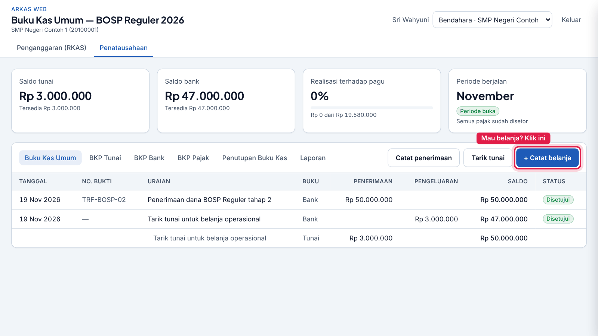{width=17cm}

**4a. Detail & saldo.** Isi tanggal, pilih cara bayar (**Non-tunai (bank)** atau **Tunai**), nomor nota, nama toko, dan uraian belanja. Penting: kalau toko nggak punya NPWP, hapus centang *Penyedia memiliki NPWP* karena tarif PPh-nya lebih tinggi. Di atas selalu ada info saldo tersedia dan saldo setelah belanja. Klik **Lanjut →**.

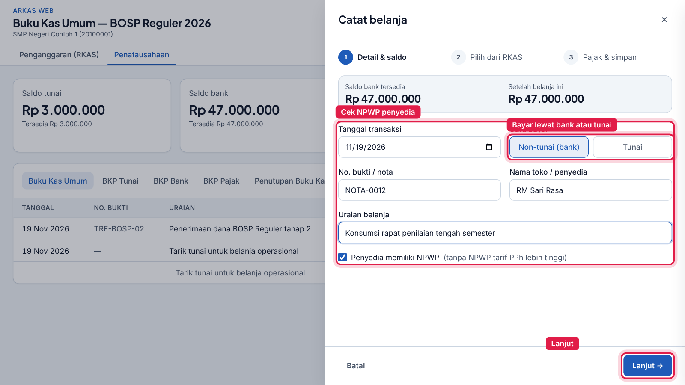{width=17cm}

**4b. Pilih dari RKAS.** Ketik kata kunci (misalnya *makan*) di kolom pencarian, lalu klik baris RKAS yang mau dibelanjakan.

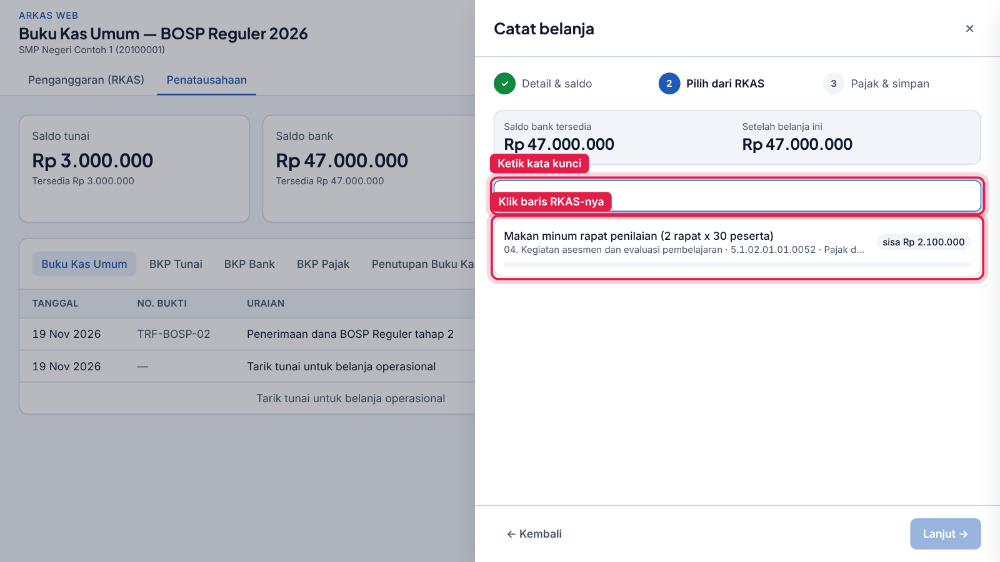{width=17cm}

Sesuaikan volume dan harga satuannya. Sisa anggaran baris itu kelihatan di bawah namanya. Kalau melebihi sisa, kotaknya jadi merah. Klik **Lanjut →**.

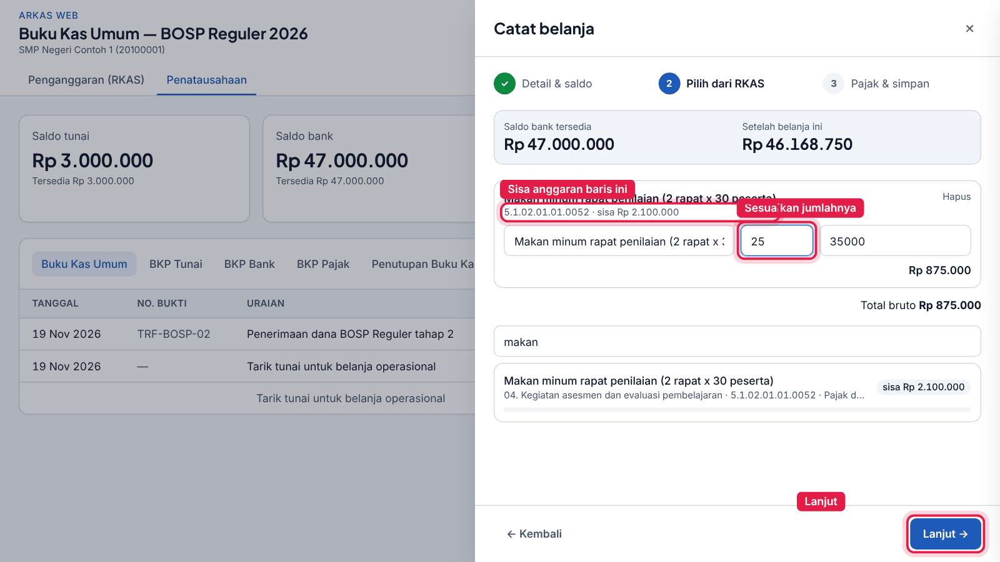{width=17cm}

**4c. Pajak & simpan.** Pajak dihitung otomatis dari kode rekening dan wilayah sekolah. Di contoh ini kena pajak daerah (SSPD) 5% sesuai Perda. Baris **Dibayar ke penyedia** adalah uang yang benar-benar kamu bayarkan ke toko. Klik **Simpan belanja**.

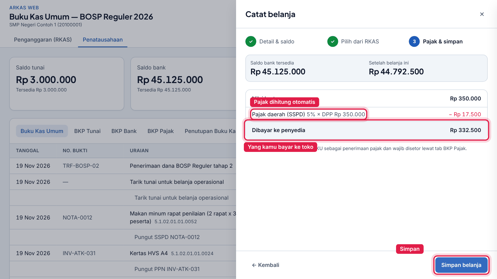{width=17cm}

Pajak yang dipotong itu belum jadi milik sekolah, ya. Itu titipan yang wajib disetor ke kas negara/daerah (lihat Langkah 5).

## Kalau catatanmu ditolak Kepala Sekolah

Nggak usah panik. Transaksi yang ditolak muncul di kotak merah **transaksi ditolak** di atas Buku Kas Umum, lengkap dengan **alasan** dari Kepala Sekolah. Transaksi itu nggak masuk saldo, jadi aman.

1. Baca alasannya baik-baik (di contoh ini: nota servis belum distempel toko).
2. Bereskan masalahnya dulu, misalnya minta toko menstempel notanya.
3. Klik **Catat ulang**. Formulir yang sesuai langsung terbuka: belanja membuka laci *Catat belanja*, penerimaan atau tarik tunai membuka dialognya dengan nilai yang sama, dan setor pajak membuka tab *BKP Pajak*.

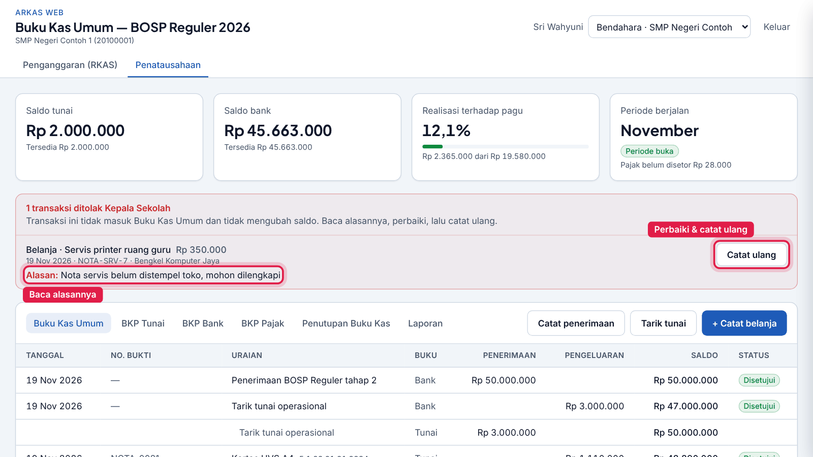{width=17cm}

Isi lagi datanya dengan benar, lalu simpan seperti biasa (ikuti Langkah 4 di atas).

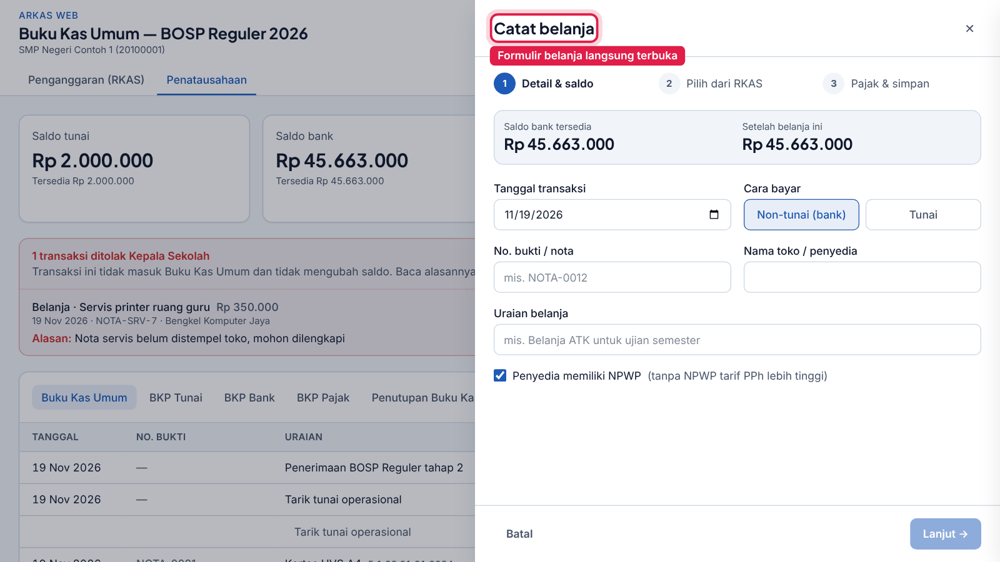{width=17cm}

*Kotak merah ini hilang sendiri setelah buku bulan itu ditutup.*

## Langkah 5: Setor pajak

Buka tab **BKP Pajak**. Di bagian *Pajak belum disetor*, centang pajak yang **sejenis** (misalnya semua SSPD), lalu klik tombol **Catat setor ...** yang muncul di kanan atas.

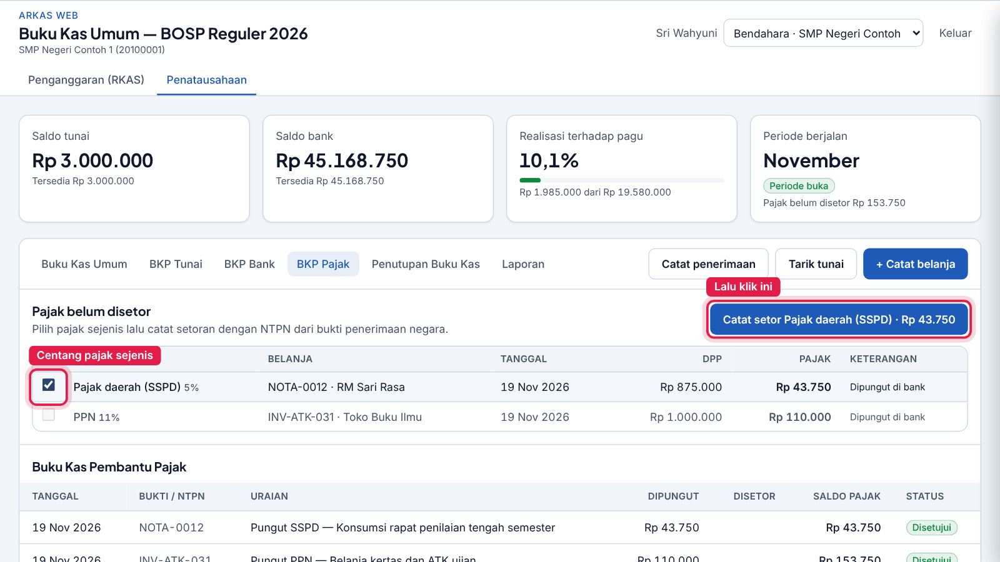{width=17cm}

Salin **NTPN** (16 karakter) dari bukti setor bank atau e-billing, cek tanggal setor dan sumber dananya, lalu klik **Simpan setoran**. Satu NTPN hanya bisa dipakai sekali.

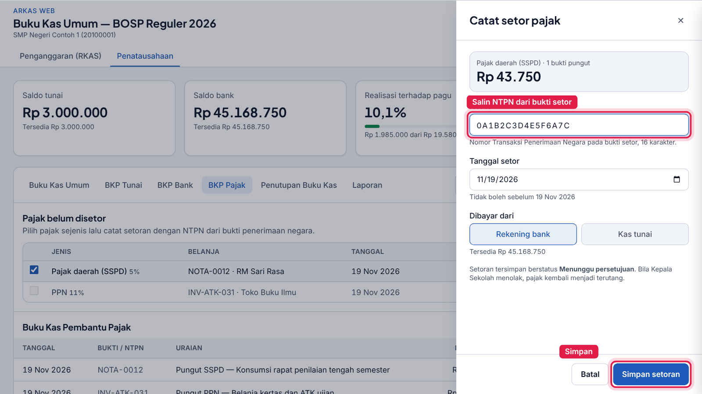{width=17cm}

Setelah disetujui Kepala Sekolah, riwayat pungut dan setor tercatat rapi di **Buku Kas Pembantu Pajak**.

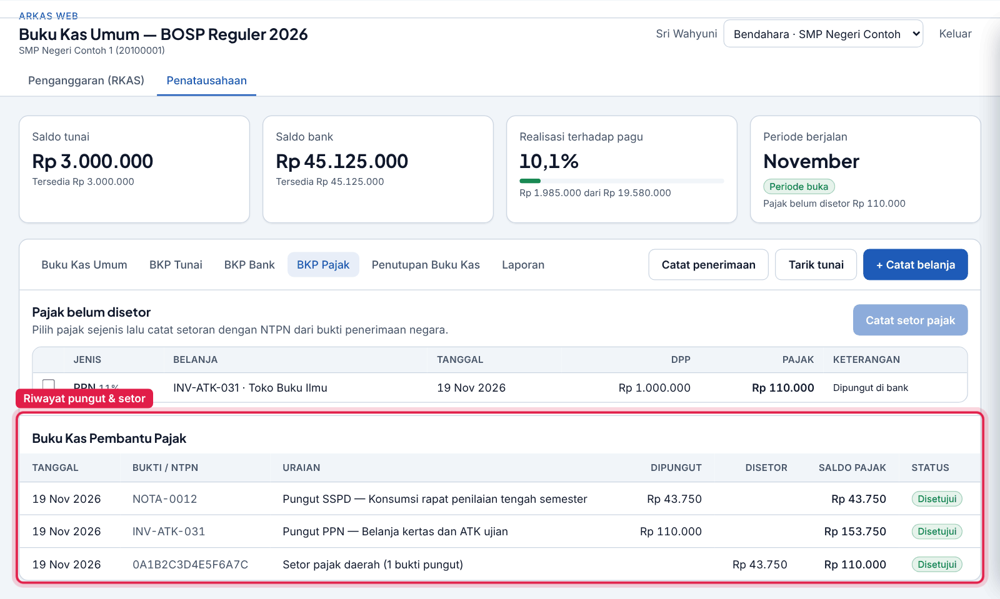{width=17cm}

Mau lihat uang tunai atau bank saja? Pakai tab **BKP Tunai** dan **BKP Bank**.

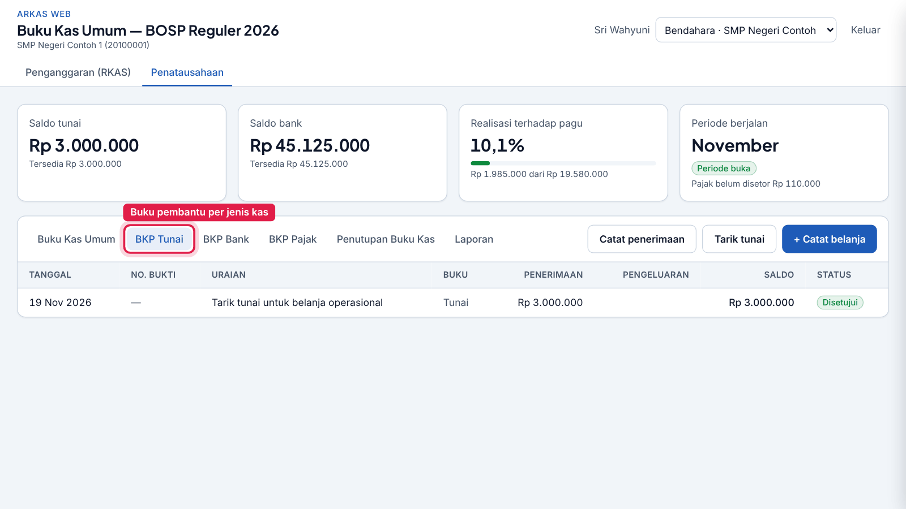{width=17cm}

## Langkah 6: Tutup buku di akhir bulan

Tiap akhir bulan, buka tab **Penutupan Buku Kas**. Cek **Daftar periksa penutupan**: semua harus centang hijau. Artinya semua transaksi sudah diputuskan Kepala Sekolah dan bulan sebelumnya sudah ditutup. Pajak yang belum disetor cuma muncul sebagai peringatan kuning, tapi sebaiknya disetor dulu.

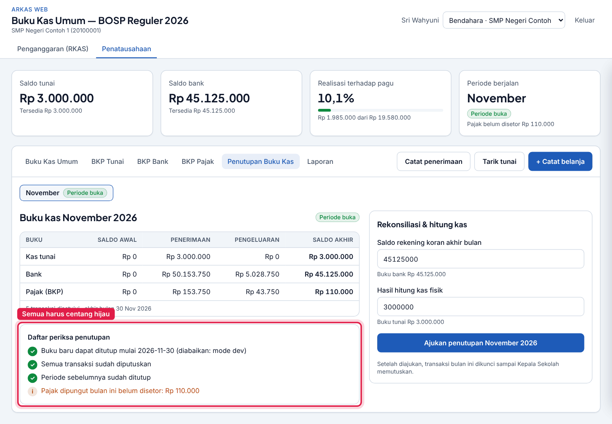{width=17cm}

Di kanan, isi **Saldo rekening koran akhir bulan** (lihat mutasi bank) dan **Hasil hitung kas fisik** (hitung uang di brankas). Kalau angkanya beda dengan buku, muncul kolom **Penjelasan selisih** yang wajib diisi minimal 10 karakter.

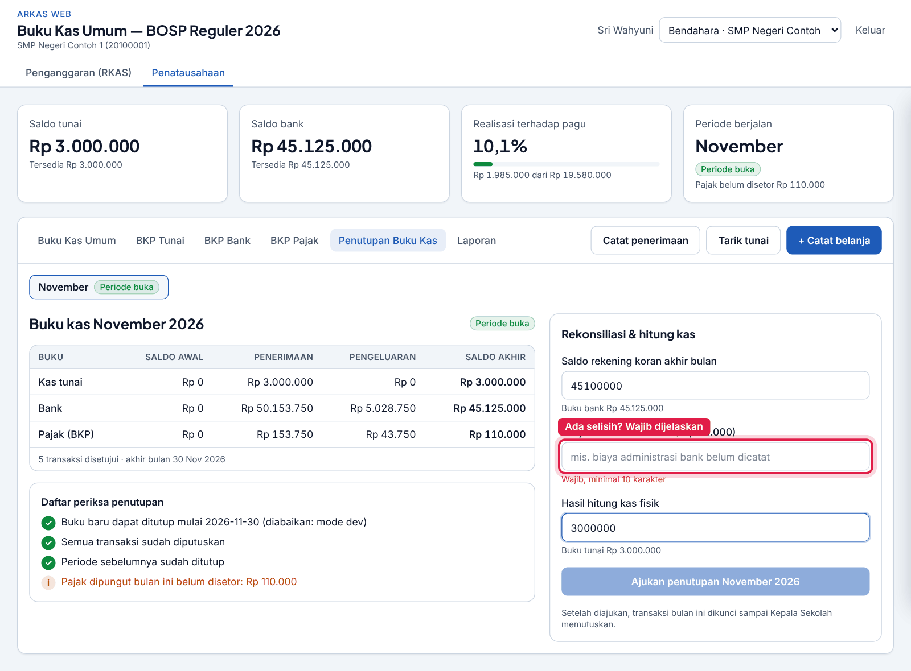{width=17cm}

Kalau angkanya sudah cocok (atau selisihnya sudah dijelaskan), klik **Ajukan penutupan** (nama bulan).

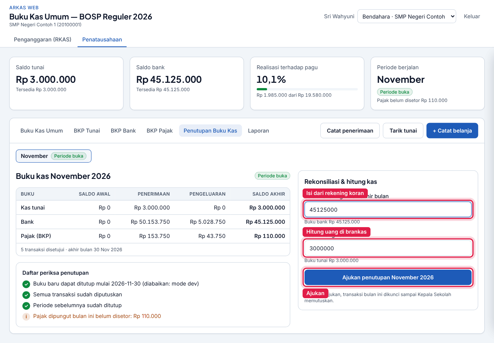{width=17cm}

Selesai! Sekarang tinggal tunggu Kepala Sekolah. Selama menunggu, transaksi bulan itu dikunci.

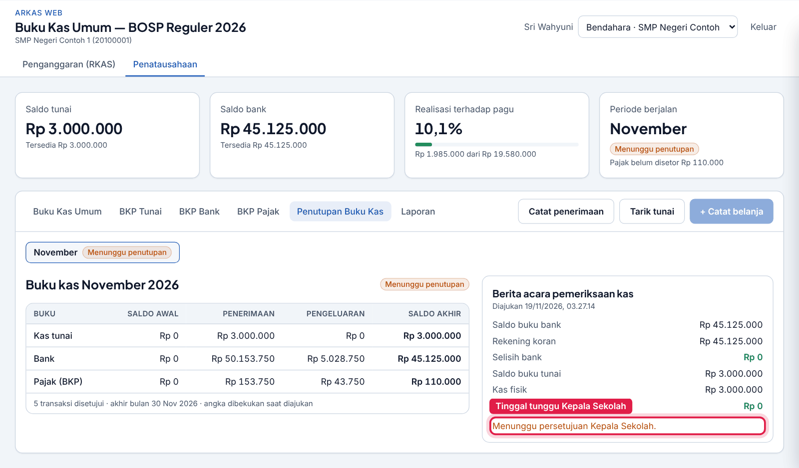{width=17cm}

## Langkah 7: Unduh laporan

Setelah Kepala Sekolah menutup buku, laporan BKU bulanan muncul di tab **Laporan**. Klik **Lihat PDF** untuk membuka atau mengunduhnya.

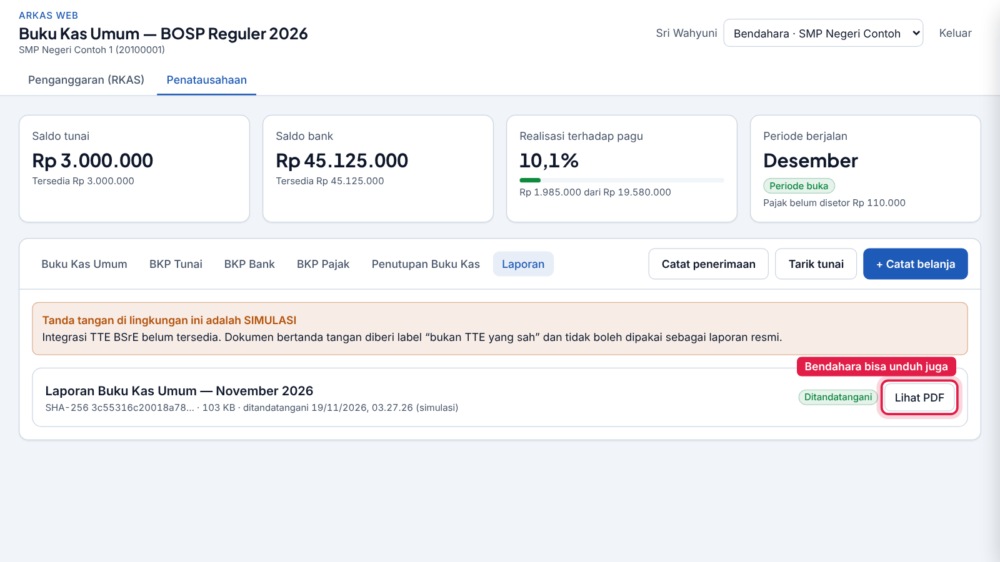{width=17cm}

# Tutorial Komite Sekolah

Sebagai Komite, Bapak/Ibu adalah **mata dan telinga** warga sekolah. Bapak/Ibu bisa melihat semua catatan keuangan sekolah, tapi nggak bisa mengubah apa pun. Jadi santai saja, nggak ada tombol yang bisa bikin salah.

## Langkah 1: Minta didaftarkan Operator

Komite masuk pakai akun SSO juga. Minta Operator sekolah mendaftarkan email SSO Bapak/Ibu dengan peran **Komite Sekolah** (lihat *Tutorial Operator, Langkah 9*). Setelah itu, masuk seperti biasa.

## Langkah 2: Pantau ringkasan dan buku kas

Begitu masuk, Bapak/Ibu langsung melihat halaman **Penatausahaan**. Di atas ada ringkasan: saldo tunai, saldo bank, persentase realisasi terhadap pagu, dan status bulan berjalan. Di bawahnya ada **Buku Kas Umum** berisi semua transaksi yang sudah disetujui.

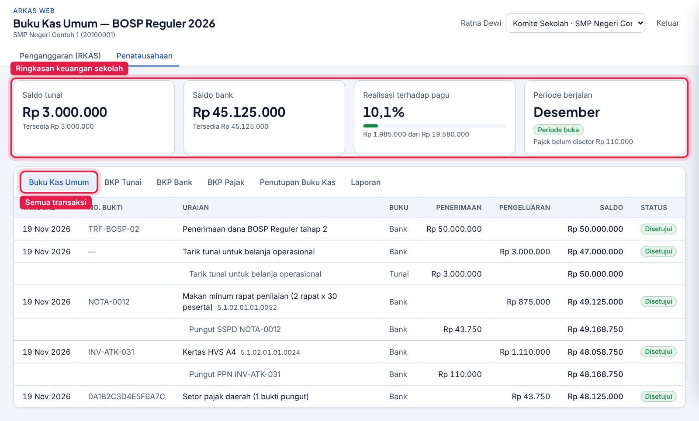{width=17cm}

## Langkah 3: Lihat RKAS

Mau tahu uang sekolah direncanakan untuk apa saja? Klik menu **Penganggaran (RKAS)**. Di situ ada pagu, rincian tiap komponen, dan setiap baris belanja beserta realisasinya.

{width=17cm}

## Langkah 4: Cek pajak

Di tab **BKP Pajak**, Bapak/Ibu bisa memastikan pajak yang dipotong dari belanja sudah disetor. Kalau masih ada di *Pajak belum disetor* lama-lama, boleh ditanyakan ke Bendahara.

{width=17cm}

## Langkah 5: Unduh laporan bulanan

Buka tab **Laporan**, lalu klik **Lihat PDF**. Laporan ini sama persis dengan yang ditandatangani Kepala Sekolah, jadi bisa dipakai untuk rapat komite.

{width=17cm}

# Kalau ada yang macet

Tenang, hampir semua masalah ada penjelasannya. Kalau muncul kotak merah, baca pesannya dan lihat tabel ini. Kalau masih bingung, kirim tangkapan layar beserta **kode** di kotak merah itu ke Operator atau Dinas.

| Kamu lihat... | Artinya | Yang perlu dilakukan |
|---|---|---|
| *RKAS belum disahkan* | Buku kas belum dibuka | Pastikan RKAS sudah diajukan Kepala Sekolah dan disahkan Dinas |
| *Belum dapat diajukan* (kotak kuning di RKAS) | Masih ada sisa pagu atau ada komponen melebihi batas | Lengkapi baris sampai sisa pagu Rp 0 dan semua komponen dalam batas |
| *Saldo tunai belum cukup* / *Saldo bank tidak cukup* | Uang di buku yang dipilih kurang | Catat penerimaan atau tarik tunai dulu, lalu tunggu disetujui |
| Tarik tunai gagal disimpan | Saldo bank belum cukup | Pastikan penerimaan sudah disetujui Kepala Sekolah |
| Baris belanja berwarna merah | Melebihi sisa anggaran baris RKAS | Kurangi nilainya, atau minta Operator membuat pergeseran RKAS |
| PEMISAHAN_TUGAS | Orang yang mencatat mencoba menyetujui sendiri | Persetujuan harus oleh Kepala Sekolah |
| PERIODE_TERTUTUP | Bulan itu sudah diajukan atau ditutup | Catat di bulan berjalan, atau minta Kepala Sekolah mengembalikan pengajuan tutup buku |
| NTPN_TIDAK_VALID / NTPN_SUDAH_DIPAKAI | NTPN bukan 16 karakter, atau sudah dipakai | Salin ulang NTPN dari bukti setor |
| Tombol *Ajukan penutupan* abu-abu | Ada centang yang belum hijau, atau selisih belum dijelaskan | Selesaikan daftar periksa dan isi penjelasan selisih |
| *Akun Anda belum memiliki peran aktif* | Akun SSO belum didaftarkan | Minta Operator atau Admin Dinas mendaftarkan emailmu |

## Pertanyaan yang sering muncul

- *Transaksi salah, padahal sudah disetujui. Bisa dihapus?* Nggak bisa, demi jejak audit. Catat transaksi koreksi dengan uraian yang jelas.
- *Transaksiku ditolak, kok hilang?* Nggak hilang, kok. Transaksi yang ditolak pindah ke kotak merah di atas Buku Kas Umum beserta alasannya. Perbaiki, lalu klik **Catat ulang**.
- *Kenapa tarif pajak daerah di sekolahku beda dengan sekolah lain?* Tarif SSPD mengikuti Perda wilayah masing-masing yang ditetapkan Dinas.
- *Aku Bendahara sekaligus Operator, kok tombolnya beda-beda?* Tombol mengikuti tugas yang sedang aktif. Ganti di pojok kanan atas.
